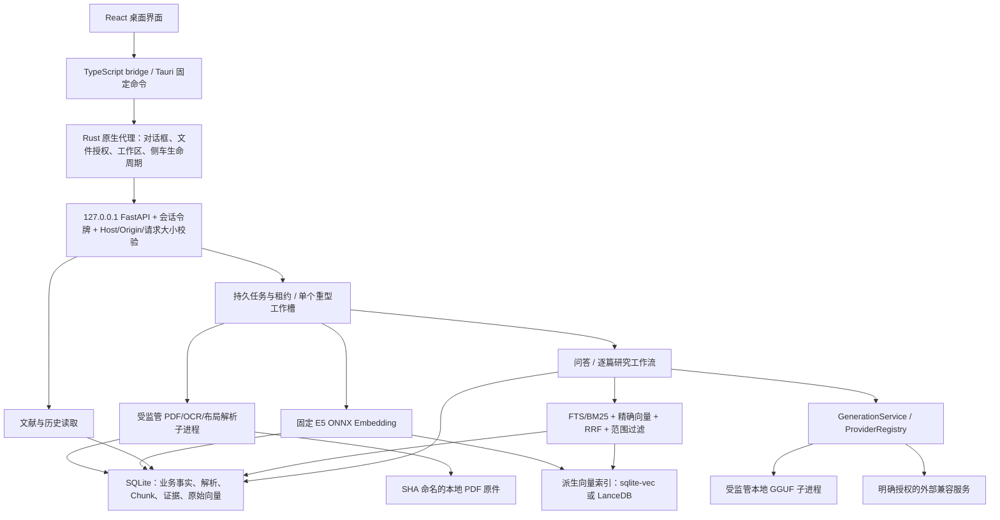
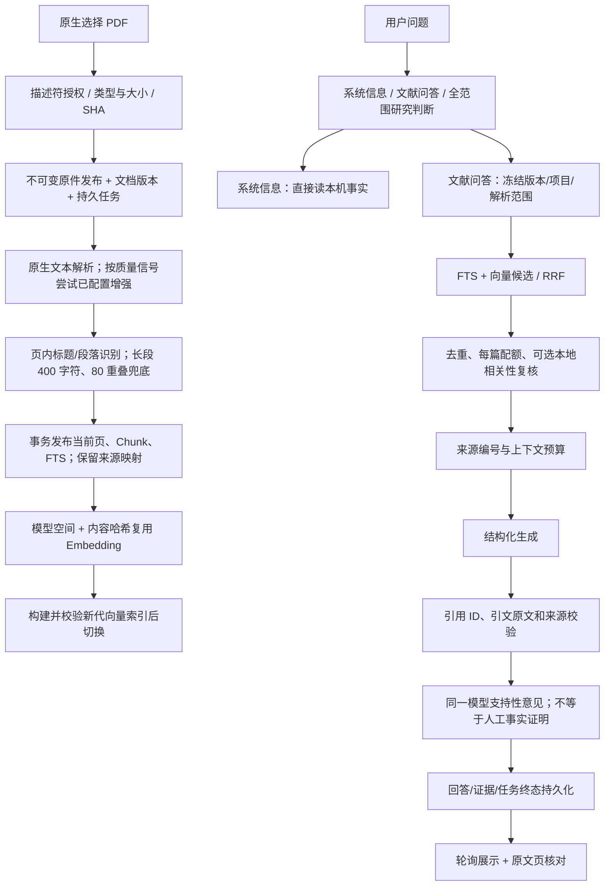

# RAGTest 仓库级代码与架构审查报告

**审查日期：2026-11-07**  
**仓库：maczhouyi-del/RAGTest**  
**固定提交：`00f8f6bc5b06889269454000f66e289b0c491f08`**  
**执行边界：只读审查；未修改项目源码、依赖、配置、数据库或索引；未调用付费模型 API。**

## 审查口径与重要限制

本次使用 GitHub 只读接口获取固定提交的目录、关键源码、测试、配置和 CI 记录；没有可运行的完整本地检出。完成了主要生产调用链的跨模块审查，但**不是每个文件逐行穷尽审计**。覆盖与未覆盖项在第八节列明。历史 README 中的本机结果不当作本提交的新测试结果。

“代码确认”表示控制流、校验缺口或重复工作可直接从源码确定，不表示每个场景均已在完整桌面应用复现。“潜在风险”表示风险条件明确，但真实发生概率或性能幅度需实验。“验收缺口”不等于功能不存在，更不等于已测出较差准确率。

结论分布：**P0 未确认；P1 6 项；P2 12 项；未为凑数单列 P3。** 其中包含确定性缺陷、可确认的低效路径以及发布/质量验收缺口，不是“18 个已复现安全漏洞”。

## 一、项目总体评价

### 1.1 定位应先纠正

项目实际是 **React + Tauri + 本地 Python 侧车 + SQLite 的单用户本地科研文献桌面系统**，不是面向不可信多用户的 Web SaaS。项目/文献范围是本地数据组织边界，不能直接视为租户 ACL，也不应机械要求 JWT、OAuth、Redis、微服务或分布式任务队列。

主要功能已覆盖 PDF 批量导入与去重、版本/项目管理、元数据候选及人工修订、原文阅读与页级引用、原生解析及可选 OCR/布局表格增强、向量缓存与混合检索、结构化问答、本地/授权外部模型、会话管理、逐篇研究检查点、证据人工复核、备份与全新恢复副本。当前主界面只有问答、文献、设置，较复杂 Research 工作台保留但不作为一级入口。

### 1.2 成熟度判断

| 方面 | 判断 |
|---|---|
| 功能完整性 | 已有较完整主链路，不是只有 README 的概念原型；高级研究入口与当前 MVP 主入口需要区分。 |
| 本地安全边界 | 原生固定命令、会话鉴权、文件授权、模型指纹、引用校验等设计较充分；不能据此宣布完成安全认证。 |
| 数据一致性 | 有事务、租约、不可变原件和新代索引发布；恢复身份绑定与异常资源释放仍有 P1 缺陷。 |
| 前端 | 主要流程和错误提示存在；轮询、任务终态和异常恢复尚有集成问题。 |
| RAG 效果 | 检索/引用工程约束较清楚；真实人工金标与已批准质量基线不足，不能给出准确率结论。 |
| 生产准备 | 当前适合作为受控本地开发预览；不宜视为已经完成稳定发行验收。 |

### 1.3 应保留的优势

数据库开启 WAL、外键和明确事务；迁移有 SHA 指纹与升级前备份。PDF 按内容哈希保存，文档版本和解析运行分离。解析发布与任务完成绑定事务，新代索引校验后才切换。Embedding 按模型空间和文本哈希复用。检索后端强制执行范围约束，不仅靠界面传参。系统信息问答能读取本机配置而不必经过文献检索。模型引用有效性、模型支持性意见与人工确认分别记录，避免把三个概念混同。

### 1.4 最重要的差距

优先处理恢复流程可能阻断启动、恢复原件身份漂移、唯一重型槽位泄漏、retry_wait 无可达操作、批量准备 419 个版本边界和失败的依赖审计门禁。其次才是轮询/数据库批处理和真实 RAG 质量实验。没有证据支持现在就更换 SQLite 或引入分布式架构。

## 二、架构分析

### 2.1 目录和技术栈

| 目录/文件 | 实际职责 |
|---|---|
| `apps/desktop/src` | React/TypeScript 界面、桥接类型、文献/问答/设置及阅读组件。 |
| `apps/desktop/src-tauri/src/lib.rs` | 原生固定命令、系统对话框授权、引擎请求代理、工作区切换。 |
| `apps/desktop/src-tauri/src/sidecar.rs` | 侧车生命周期、就绪协议、请求超时及进程状态。 |
| `engine/ragsystem/__main__.py` | Python 进程入口、工作区占用、恢复和本机服务启动。 |
| `ipc/` | FastAPI 路由、严格 DTO、边界鉴权、文件与目录授权。 |
| `ingestion/`, `library/`, `jobs/` | 原件导入、文献元数据/身份/生命周期、持久任务与租约。 |
| `parsing/`, `chunking/` | PDFium、可选 Tesseract/Docling、结构切分与来源映射。 |
| `indexing/`, `vector_adapters/`, `retrieval/` | Embedding 缓存、sqlite-vec/LanceDB、FTS/向量/RRF/可选复核。 |
| `models/`, `workflows/`, `verification/` | 本地/外部生成、问答与逐篇研究、引用和支持性检查。 |
| `storage/migrations/` | SQLite schema；`Database.SCHEMA_VERSION=21`。 |
| `contracts/`, `docs/`, `specs/` | 协议、工程/评估/设计资料；并非本次全部逐行审完。 |
| `tests/`, `tools/`, `packaging/`, `.github/` | 测试、浏览器/评估工具、PyInstaller 侧车构建、CI。 |

锁定清单可见：React 19、TypeScript 7、Vite 8、Tauri 2、Python 3.12；后端使用 FastAPI/Uvicorn、SQLite、pypdfium2。向量路径为固定候选 multilingual-e5-small/ONNX，384 维、512 Token；生成候选为固定版本 Qwen2.5-1.5B GGUF，或显式配置的兼容外部服务。以上是**仓库使用情况**，不是对当前最新版本或这些版本无漏洞的声明。

配置入口主要是 `pyproject.toml/uv.lock`、前端 `package.json/package-lock.json`、Tauri 配置/Cargo 锁、SQLite `app_settings` 与模型目录授权。开发工作区可通过 `RAGSYSTEM_DEV_DATA_ROOT` 选择；模型资源由用户明确准备，构建脚本 `--include-*-lab` 控制是否打包相应运行时。外部服务密钥仅保留当前引擎会话内存，配置和文献外发授权按修订绑定。

### 2.2 整体架构

React 不是直接访问本机引擎 HTTP。Rust 保管会话信息并将固定命令转换为本机请求。长任务通过返回任务/回答标识后轮询观察，不是 SSE/WebSocket Token 流。

### 2.3 主要接口与实体

接口组包括 `/v0/documents`、`/v0/documents/{id}/parse`、`/v0/search`、`/v0/index`、`/v0/answers`、`/v0/conversations`、`/v0/jobs/{job_id}`、`/v0/generation-providers` 和备份/恢复相关路由。普通请求上限 16 KiB，部分范围型接口 128 KiB；任务载荷另有限制，见问题 05。

核心关系是：

`Document → DocumentVersion → ParseRun → Element/已发布页 → Chunk → ChunkEmbeddingLink → EmbeddingRecord → EmbeddingSpace`

`DocumentVersion` 绑定 `FileAsset.sha256`；一个逻辑论文可有不同文件版本，一个版本可有多次解析。向量记录按 `(space_id, content_sha256)` 去重，因此不是“一条 Chunk 必须对应一条永久独占向量”。会话、回答、范围快照、证据、结论、研究计划与报告修订是另一组业务实体。SQLite 是业务事实存储，派生向量索引可以重建，不应反过来成为唯一文献事实来源。

### 2.4 文档与 RAG 完整数据流

### 2.5 README 与实现一致性

README 正确把项目称为本地开发预览，并区分源码、模型资源、历史本机产物与正式发行；说明了页级引用、Research 隐藏入口、模型自审不能代替科研核验及容量/质量仍待验证。这些与主链路一致。

需要收紧的表述是“任务重试/取消”和“不可变原件恢复”的适用范围：正常路径已有保护，但问题 01–04、07 表明不能将其概括为所有失败场景均可靠。README 历史 Python/浏览器测试数量不是本提交本次重跑的结果。根目录设计 DOCX、所有历史工程报告和全部 contracts 本次未逐段对照，因此不声称完成了对全部设计资料的穷尽一致性审查。

## 三、问题清单

以下按优先级排列。同优先级按数据完整性、可用性、用户触发范围及修复收益综合排序。源码链接全部固定到本次提交，行号为原文件行号，而非连接器返回 JSON 的包装行号。

### RAG-AUD-01｜P1｜单个待恢复原件异常可以阻断整个引擎启动

**类别：** 后端 / 稳定性  
**证据级别：** 已确认的异常传播路径；完整侧车故障注入未执行  
**位置：** [`engine/ragsystem/ipc/server.py:300–312`](https://github.com/maczhouyi-del/RAGTest/blob/00f8f6bc5b06889269454000f66e289b0c491f08/engine/ragsystem/ipc/server.py#L300-L312)；[`engine/ragsystem/ingestion/import_pdf.py:152–177`](https://github.com/maczhouyi-del/RAGTest/blob/00f8f6bc5b06889269454000f66e289b0c491f08/engine/ragsystem/ingestion/import_pdf.py#L152-L177)

**代码/调用链证据：** lifespan 在 yield 前直接调用 importer.recover_published_imports()。恢复循环对每条记录只有 finally 释放 Grants，没有隔离该记录的授权、读取或恢复异常。

**触发条件：** 上次导入在原件发布后、数据库提交前中断；保留的 PDF 随后损坏、变得不可读或不再通过文件头校验。

**影响：** 一个待恢复对象的错误能够让 FastAPI 启动失败，其他完好文献也无法通过界面使用；错误被放大为整个工作区不可用。

**修复建议：** 逐条恢复时捕获可隔离的对象级错误，记录带 job_id/预期 SHA 的失败状态并保留隔离对象，继续恢复其他任务。数据库本身损坏等全局错误仍应明确阻止启动，不能笼统吞掉所有异常。  
**复杂度：** 中

**验收方法：** 在临时工作区构造“已发布但未提交”的导入，破坏其中一份原件，保留另一份正常文献；重启应可读取正常文献，坏任务出现准确错误，且不得删除原件或自动把损坏内容当作成功。

### RAG-AUD-02｜P1｜恢复导入没有把重新读取的文件哈希绑定到原任务预期哈希

**类别：** 后端 / 数据完整性  
**证据级别：** 已确认的校验缺口；内容替换场景需补集成测试  
**位置：** [`engine/ragsystem/ingestion/import_pdf.py:31–112`](https://github.com/maczhouyi-del/RAGTest/blob/00f8f6bc5b06889269454000f66e289b0c491f08/engine/ragsystem/ingestion/import_pdf.py#L31-L112)；[`engine/ragsystem/ingestion/import_pdf.py:152–196`](https://github.com/maczhouyi-del/RAGTest/blob/00f8f6bc5b06889269454000f66e289b0c491f08/engine/ragsystem/ingestion/import_pdf.py#L152-L196)

**代码/调用链证据：** recover_published_imports/resume 以 payload 中的 digest 找到 papers/<digest>.pdf，再用 Grants.issue 计算当前文件哈希；随后 run 使用 grant.sha256 发布和入库，没有先比较 grant.sha256 与原任务 payload.sha256。

**触发条件：** 崩溃后保留的 A 哈希路径下文件被换成仍能通过 PDF 头检查的 B；或恢复前发生仍保留有效头部的内容破坏。

**影响：** 原本对应 A 的任务可能以 B 的身份完成，并创建另一份内容记录，而非报告原件身份损坏。正常导入路径已有校验，不能据此推定恢复路径也安全。

**修复建议：** 恢复授权后、领取任务前核对预期 SHA；在共同 run 边界再次断言任务预期 SHA 与 grant SHA 一致。可用时同时核对预期字节数，不一致应返回 OBJECT_CORRUPT/恢复专用错误并保留现场。  
**复杂度：** 低—中

**验收方法：** 在原件发布后注入崩溃，将 A 路径内容替换为有效 PDF B，分别调用启动恢复和手动 resume；不得产生 B 的文档版本，不得将 A 任务标记 completed。

### RAG-AUD-03｜P1｜模型配置任务领取失败时泄漏唯一重型工作槽

**类别：** 后端 / 并发与稳定性  
**证据级别：** 代码确认，并已通过独立源片段故障注入复现；不是仓库集成测试  
**位置：** [`engine/ragsystem/ipc/server.py:888–981`](https://github.com/maczhouyi-del/RAGTest/blob/00f8f6bc5b06889269454000f66e289b0c491f08/engine/ragsystem/ipc/server.py#L888-L981)

**代码/调用链证据：** run_docling_configuration、run_ocr_configuration、run_generator 都在 try/finally 之前调用 jobs.claim(...)；slot.release() 位于之后的 finally。领取任务发生异常时不会进入该 finally。

**触发条件：** 领取任务时 SQLite 锁超时、数据库 I/O 等异常。数据库 busy_timeout 为 3000 ms，不应把领取视为不会失败。

**影响：** BoundedSemaphore(1) 保持占用；后续解析、索引、问答等重任务持续返回 WORKER_BUSY，直到重启。独立检查中注入 sqlite3.OperationalError 后再次 acquire(blocking=False) 返回 False。

**修复建议：** 把领取、业务执行和失败标记都放入覆盖完整生命周期的资源管理边界；初始化 job=None，并确保失败状态写入再抛错时仍无条件释放工作槽。统一此类 worker 包装器。  
**复杂度：** 低—中

**验收方法：** 分别在 claim、业务执行、jobs.fail 中注入异常，验证槽位只释放一次，下一项重任务能受理，原任务保留可诊断终态。

### RAG-AUD-04｜P1｜重启后的 retry_wait 任务缺少可达终结路径，并阻止切换恢复副本

**类别：** 前后端集成 / 恢复  
**证据级别：** 跨模块代码确认；原生界面操作复现未执行  
**位置：** [`engine/ragsystem/jobs/repository.py:203–239`](https://github.com/maczhouyi-del/RAGTest/blob/00f8f6bc5b06889269454000f66e289b0c491f08/engine/ragsystem/jobs/repository.py#L203-L239)；[`apps/desktop/src/components/MvpLibrary.tsx:14–33`](https://github.com/maczhouyi-del/RAGTest/blob/00f8f6bc5b06889269454000f66e289b0c491f08/apps/desktop/src/components/MvpLibrary.tsx#L14-L33)；[`engine/ragsystem/storage/backup_service.py:102–113`](https://github.com/maczhouyi-del/RAGTest/blob/00f8f6bc5b06889269454000f66e289b0c491f08/engine/ragsystem/storage/backup_service.py#L102-L113)

**代码/调用链证据：** recover_owned_workspace 将部分 running/queued 任务改为 retry_wait。MVP 队列只允许取消 queued/running，重试仅覆盖 import/parse_page/metadata_extract。restored_path 则将任意 queued/running/retry_wait 视为阻止工作区切换的条件。

**触发条件：** 索引、模型配置、问答等任务执行中退出或崩溃，重启后留下 retry_wait；用户尝试使用已经成功恢复的副本。

**影响：** 界面可能显示“当前无运行任务”，但切换恢复副本被 WORKER_BUSY 拒绝；重建新的任务也不会自动终结旧记录。不能将“重试/取消已实现”理解为所有任务类型均已闭环。

**修复建议：** 明确每个任务类型的恢复策略：可续跑、需重新授权、需重新提交或终止。允许用户取消所有可取消的非终态意图；切换检查区分实际持有工作资源的任务和已失去运行者的历史意图，并保证安全终结。  
**复杂度：** 中

**验收方法：** 对 import/parse/index/prepare/answer/config/backup 分别在 queued 和 running 时重启；每种任务都必须有可达的继续或终止操作，终结后恢复副本可激活。

### RAG-AUD-05｜P1｜准备接口声明支持 1000 个版本，内部任务在 419 个 UUID 时即超限

**类别：** 后端 / 容量契约  
**证据级别：** 代码确认，已执行精确序列化边界复算  
**位置：** [`engine/ragsystem/ipc/mvp.py:12–15`](https://github.com/maczhouyi-del/RAGTest/blob/00f8f6bc5b06889269454000f66e289b0c491f08/engine/ragsystem/ipc/mvp.py#L12-L15)；[`engine/ragsystem/ipc/mvp.py:116–143`](https://github.com/maczhouyi-del/RAGTest/blob/00f8f6bc5b06889269454000f66e289b0c491f08/engine/ragsystem/ipc/mvp.py#L116-L143)；[`engine/ragsystem/jobs/repository.py:33–41`](https://github.com/maczhouyi-del/RAGTest/blob/00f8f6bc5b06889269454000f66e289b0c491f08/engine/ragsystem/jobs/repository.py#L33-L41)；[`engine/ragsystem/ipc/server.py:36–46`](https://github.com/maczhouyi-del/RAGTest/blob/00f8f6bc5b06889269454000f66e289b0c491f08/engine/ragsystem/ipc/server.py#L36-L46)；[`apps/desktop/src/components/MvpLibrary.tsx:22–22`](https://github.com/maczhouyi-del/RAGTest/blob/00f8f6bc5b06889269454000f66e289b0c491f08/apps/desktop/src/components/MvpLibrary.tsx#L22)

**代码/调用链证据：** PrepareRequest.version_ids 上限 1000；prepare_documents 将完整 versions 列表写入 job payload；Jobs.enqueue 的紧凑 UTF-8 JSON 上限 16384 字节。该 endpoint 的 HTTP 上限是 128 KiB，因此不是外层 16 KiB 请求限制先触发。

**触发条件：** 一次“准备问答 / 更新索引”提交至少 419 个标准 36 字符 UUID（实际载荷结构不变）。

**影响：** 418 个为 16368 B，419 个为 16407 B，1000 个为 39066 B；419 起在入队时抛 PAYLOAD_TOO_LARGE。文献页未选择子集时会发送全库版本列表，影响目标规模下的正常入口。

**修复建议：** 将版本清单存为有界任务子表或冻结范围快照，任务只引用 snapshot_id；统一 HTTP、DTO、任务载荷与前端边界。不要只将所有通用载荷上限无限放大。  
**复杂度：** 中

**验收方法：** 在临时库测试 1/418/419/1000 个不同有效版本，覆盖取消、重启、部分失败和幂等重提；明确区分接口接收、任务入队与处理完成。

### RAG-AUD-06｜P1｜当前提交的依赖审计门禁失败，尚未完成发布风险处置

**类别：** 安全 / 工程发布  
**证据级别：** 当前提交 CI 状态已核验；各公告在目标产物中的可利用性未验证  
**位置：** [`.github/workflows/ci.yml:76–87`](https://github.com/maczhouyi-del/RAGTest/blob/00f8f6bc5b06889269454000f66e289b0c491f08/.github/workflows/ci.yml#L76-L87)

**代码/调用链证据：** Actions run 42369976421：Windows 与 macOS 的 source job 成功，但 lock-audit job 128395893056 失败，整个工作流结论为 failure。读取到的日志报告 lock_integrity PASS、vulnerability_audit FAIL、license_review BLOCKED，存在 diskcache、glib 等公告命中。

**触发条件：** 把该提交当作安全门禁全绿、可以发行的版本。公告命中是待分析材料，不等于已验证远程可利用漏洞。

**影响：** 目标平台、可选运行时、依赖到打包产物的映射和漏洞可达性尚未闭环；不能用两个源码验证 job 成功覆盖总体工作流失败。

**修复建议：** 按准确锁定版本和目标产物分层核查，合并同一漏洞的公告别名；评估实际调用路径和平台条件，升级可修复依赖并回归。确实不适用的项需要有依据、有期限的例外，不得整体关闭审计。  
**复杂度：** 中—高，取决于上游兼容性

**验收方法：** 同一提交的审计、源码测试和实际目标包 SBOM/许可清单一致；所有告警均有修复或审查结论。这里没有声称公告已具备可利用 PoC。

### RAG-AUD-07｜P2｜领取前取消问答，只终止 job，可能留下永久 queued 的回答

**类别：** 后端 / 前端状态一致性  
**证据级别：** 静态调用链确认；时序集成测试待补  
**位置：** [`engine/ragsystem/ipc/server.py:577–580`](https://github.com/maczhouyi-del/RAGTest/blob/00f8f6bc5b06889269454000f66e289b0c491f08/engine/ragsystem/ipc/server.py#L577-L580)；[`engine/ragsystem/jobs/repository.py:168–183`](https://github.com/maczhouyi-del/RAGTest/blob/00f8f6bc5b06889269454000f66e289b0c491f08/engine/ragsystem/jobs/repository.py#L168-L183)；[`engine/ragsystem/workflows/workbench.py:437–443`](https://github.com/maczhouyi-del/RAGTest/blob/00f8f6bc5b06889269454000f66e289b0c491f08/engine/ragsystem/workflows/workbench.py#L437-L443)；[`apps/desktop/src/components/MvpAsk.tsx:32–38`](https://github.com/maczhouyi-del/RAGTest/blob/00f8f6bc5b06889269454000f66e289b0c491f08/apps/desktop/src/components/MvpAsk.tsx#L32-L38)

**代码/调用链证据：** 取消路由仅调用 Jobs.cancel；该方法只更新 jobs/job_attempts/events。run_answer 在 claim 返回 None 后直接返回。前端根据 answer_runs 的 queued/running 字段设置 pending，而不是从已取消 job 反推终态。

**触发条件：** 回答已入队，但 worker 尚未领取时被取消。运行中取消有后续异常处理，不能覆盖这个领取前窗口。

**影响：** 业务回答保持 queued，界面可持续显示处理中并禁用发送。取消任务与取消业务实体并不一致。

**修复建议：** 在事务内同步关联 answer_run 的终态，或提供统一业务任务状态协调器；worker 的无可领取任务分支也应确认对应业务记录是否已终止。  
**复杂度：** 中

**验收方法：** 用同步屏障暂停 worker 在 claim 前，取消再放行；断言 job 和 answer_run 均为 cancelled、无模型调用、前端能再次发送。

### RAG-AUD-08｜P2｜对话轮询反复加载历史证据，并按证据重复读取整份 PDF 校验

**类别：** 性能 / 前后端集成  
**证据级别：** 重复读取路径已确认；实际延迟、CPU 与内存峰值待测  
**位置：** [`apps/desktop/src/components/MvpAsk.tsx:32–38`](https://github.com/maczhouyi-del/RAGTest/blob/00f8f6bc5b06889269454000f66e289b0c491f08/apps/desktop/src/components/MvpAsk.tsx#L32-L38)；[`engine/ragsystem/retrieval/source_search.py:132–153`](https://github.com/maczhouyi-del/RAGTest/blob/00f8f6bc5b06889269454000f66e289b0c491f08/engine/ragsystem/retrieval/source_search.py#L132-L153)；[`engine/ragsystem/workflows/workbench.py:866–910`](https://github.com/maczhouyi-del/RAGTest/blob/00f8f6bc5b06889269454000f66e289b0c491f08/engine/ragsystem/workflows/workbench.py#L866-L910)

**代码/调用链证据：** 会话选定后每 1000 ms 拉取 conversationTurns；答案展示逐条 public_evidence→Sources.anchor，anchor 以 path.read_bytes() 读取整份 PDF 计算 SHA。Rust 侧共享引擎互斥锁还会使慢请求阻塞其他命令。

**触发条件：** 含多条证据、多个历史回答的会话保持打开；多条证据来自同一份较大的 PDF 时重复尤其明显。

**影响：** 已确认应用层重复读取、分配和哈希工作，不能直接等同于每次都发生物理磁盘 I/O（操作系统可能缓存）。即使没有新答案，仍会重复工作；具体卡顿程度需实测。

**修复建议：** 将轻量任务状态与完整答案分开；仅活动任务轮询并暂停隐藏页面；相同原件在单次请求内去重验证。跨请求缓存须绑定文件身份/变化检测，并在实际打开原文等安全边界保留可靠校验，不能简单删除哈希保护。  
**复杂度：** 中

**验收方法：** 为文件读取和 SHA 计算加计数；同一响应中同一原件不应按证据条数重复验证。用 1/30 轮会话和不同 PDF 大小比较冷/热缓存 P50/P95，同时回归原件篡改检测。

### RAG-AUD-09｜P2｜文献列表存在 N+1 查询，周期性全量快照放大成本

**类别：** 后端 / 数据库性能  
**证据级别：** 查询数量随文献数线性增加已确认；目标规模时延待测  
**位置：** [`engine/ragsystem/library/repository.py:127–207`](https://github.com/maczhouyi-del/RAGTest/blob/00f8f6bc5b06889269454000f66e289b0c491f08/engine/ragsystem/library/repository.py#L127-L207)；[`engine/ragsystem/library/repository.py:227–247`](https://github.com/maczhouyi-del/RAGTest/blob/00f8f6bc5b06889269454000f66e289b0c491f08/engine/ragsystem/library/repository.py#L227-L247)；[`engine/ragsystem/library/repository.py:300–306`](https://github.com/maczhouyi-del/RAGTest/blob/00f8f6bc5b06889269454000f66e289b0c491f08/engine/ragsystem/library/repository.py#L300-L306)

**代码/调用链证据：** list_documents 在每个版本循环中分别查询 metadata_candidates、对应 metadata job；有 DOI 时再查 duplicate_candidates。update_metadata 还在更新前后调用全量 list_documents。App 的周期性全局快照使用该列表。

**触发条件：** 文献数量增长、持续快照刷新、频繁编辑元数据；逐篇研究中反复读全库也会放大该路径。

**影响：** 仅两个固定逐版本查询就增加约 2N 次 SELECT，另有 DOI 分支。这里没有宣称“1000 篇必然超时”，但重复查询是代码可直接确定的。

**修复建议：** 批量读取候选、任务状态和 DOI 分组，构建内存映射；单条编辑使用定向读取；把列表摘要和详情分开，按 revision/分页增量刷新。  
**复杂度：** 中

**验收方法：** 使用 SQLite trace_callback 统计查询次数，证明不再随每条文献增加固定 SQL 次数；测试候选覆盖、自动/人工字段优先级、项目范围与 DOI 去重结果一致。

### RAG-AUD-10｜P2｜成功导入和重复导入仍永久保留新建 staging 文件

**类别：** 后端 / 存储容量  
**证据级别：** 导入成功路径未清理已确认；整库历史垃圾总量未测  
**位置：** [`engine/ragsystem/ingestion/import_pdf.py:31–120`](https://github.com/maczhouyi-del/RAGTest/blob/00f8f6bc5b06889269454000f66e289b0c491f08/engine/ragsystem/ingestion/import_pdf.py#L31-L120)

**代码/调用链证据：** 每次 run 都新建 job_id+随机值的 .part；通过 os.link 发布，不论目标已存在还是本次任务成功，finally 只关闭授权文件句柄，没有对本任务 staging 对象做成功后的处理。

**触发条件：** 同一个 PDF 多次导入，或大量导入/重试。

**影响：** 首次成功导入时 staging 与 papers 可共享硬链接 inode，不能说立刻占两倍磁盘；重复导入时新临时副本与已存在原件通常不是同一 inode，保留会真实增加占用。保留崩溃证据本身合理，但不应无限保留所有成功临时副本。

**修复建议：** 按任务归属、终态和租约建立清理/保留策略；成功且原件/事务均已确认后处理本任务临时对象，失败现场按期限保留并可审计。禁止遍历删除未知用户文件。  
**复杂度：** 中

**验收方法：** 连续导入同一文件 10 次，确认文档去重且实际分配块数有界；在复制、发布、提交各阶段崩溃后仍可恢复，活跃任务临时对象不得被删除。

### RAG-AUD-11｜P2｜备份完整复制后才检查可接受容量，超限任务产生无效大副本

**类别：** 稳定性 / 备份  
**证据级别：** 检查顺序已确认；真实库触发概率未知  
**位置：** [`engine/ragsystem/storage/backup.py:50–95`](https://github.com/maczhouyi-del/RAGTest/blob/00f8f6bc5b06889269454000f66e289b0c491f08/engine/ragsystem/storage/backup.py#L50-L95)；[`engine/ragsystem/storage/backup.py:98–158`](https://github.com/maczhouyi-del/RAGTest/blob/00f8f6bc5b06889269454000f66e289b0c491f08/engine/ragsystem/storage/backup.py#L98-L158)；[`engine/ragsystem/storage/backup_service.py:35–101`](https://github.com/maczhouyi-del/RAGTest/blob/00f8f6bc5b06889269454000f66e289b0c491f08/engine/ragsystem/storage/backup_service.py#L35-L101)

**代码/调用链证据：** _create 先复制 SQLite 和所有原件；inspect 才限制总量 8 GiB、SQLite 文件 512 MiB。BackupService 创建后再 inspect，失败会保留/隔离副本。

**触发条件：** 原件加数据库超出该上限，或 SQLite 原始向量缓存使数据库超过 512 MiB。

**影响：** 在已复制大量数据后才失败，浪费时间与磁盘，反复尝试可积累隔离副本。1000 篇是否触发必须按真实文件和向量数量测量，不能只由篇数断定。

**修复建议：** 复制前计算一致的容量预估并检查目标可用空间，给出明确限制；保留复制后的完整性校验。若产品需支持更大库，应调整备份协议和分卷/流式策略，而不只是移除防御上限。  
**复杂度：** 中

**验收方法：** 构造越过数据库/总量上限的测试元数据或稀疏测试文件，验证在大规模复制前拒绝；测试复制中磁盘满、取消、隔离保留和正常恢复。

### RAG-AUD-12｜P2｜Embedding 虽然批量推理，缓存和关联仍逐条事务写入

**类别：** 性能 / 索引构建  
**证据级别：** 读写模式已确认；耗时收益需目标机器基准  
**位置：** [`engine/ragsystem/indexing/incremental.py:1–40`](https://github.com/maczhouyi-del/RAGTest/blob/00f8f6bc5b06889269454000f66e289b0c491f08/engine/ragsystem/indexing/incremental.py#L1-L40)；[`engine/ragsystem/storage/database.py:68–90`](https://github.com/maczhouyi-del/RAGTest/blob/00f8f6bc5b06889269454000f66e289b0c491f08/engine/ragsystem/storage/database.py#L68-L90)

**代码/调用链证据：** 增量索引逐项 get/persist/link；这些方法独立打开连接或提交事务。Database 使用 synchronous=FULL，因此“按批编码”不等于“按批持久化”。

**触发条件：** 首次建立大量 Chunk 索引，或大量内容需要新向量/新关联。

**影响：** 产生大量连接、事务和同步提交，压缩批量 ONNX 推理带来的收益；实际瓶颈应同时分解模型耗时与 SQLite 耗时。

**修复建议：** 采用有界批次的缓存批量读取、executemany 写入与关联提交；批次边界检查取消/租约，并保留模型空间、内容哈希去重和原子发布。  
**复杂度：** 中

**验收方法：** 比较事务数、编码数、写入数和总耗时；缓存命中不得重新编码；在批次中取消/崩溃后不得发布半成品索引。

### RAG-AUD-13｜P2｜按子串拦截 systematic review，误拒单篇论文的正常问题

**类别：** RAG / 意图路由  
**证据级别：** 确定性逻辑缺陷  
**位置：** [`engine/ragsystem/workflows/workbench.py:276–289`](https://github.com/maczhouyi-del/RAGTest/blob/00f8f6bc5b06889269454000f66e289b0c491f08/engine/ragsystem/workflows/workbench.py#L276-L289)

**代码/调用链证据：** create_answer 在意图拆分前，只要 question.casefold() 包含“所有论文/全库/all papers/every paper/systematic review”等任一片段，就抛出 RESEARCH_REQUIRED。

**触发条件：** 只选一篇文献，询问“这篇论文是否采用 systematic review 方法？”或询问原文中的这个术语。

**影响：** 普通文献问答被误认作逐篇全库研究，无论是否已有充分证据都会提前拒绝。

**修复建议：** 把“术语出现”与“要求穷尽全范围”分开，结合选定范围和明确任务语义；模糊情形说明范围或请求选择，而非仅凭词面拒答。继续保留不能用 Top-K 冒充全库覆盖的约束。  
**复杂度：** 低—中

**验收方法：** 新增单篇术语问答、引用中出现 all papers、真正要求逐篇穷尽的中英文对照用例；前两类可正常检索，后一类仍进入或提示逐篇研究。

### RAG-AUD-14｜P2｜LanceDB 路径将全部范围内向量物化为 Python 记录再截取 Top-K

**类别：** 性能 / 可选向量后端  
**证据级别：** 数据物化路径已确认；属于可选后端的容量风险，未测内存峰值  
**位置：** [`engine/ragsystem/vector_adapters/lancedb.py:52–78`](https://github.com/maczhouyi-del/RAGTest/blob/00f8f6bc5b06889269454000f66e289b0c491f08/engine/ragsystem/vector_adapters/lancedb.py#L52-L78)

**代码/调用链证据：** search 使用 limit(len(eligible)).to_list() 后进行本地排序/截取；ids 路径先 to_arrow 再取 embedding_id 列。两者可能传回远超最终 K 的数据，包括不需要的向量列。

**触发条件：** 选择 LanceDB 后端，授权范围内候选较多，而最终只需要很小的 K。

**影响：** 增加 Arrow/Python 对象转换和内存开销。精确检索本身不构成缺陷；问题是为 Top-K 结果搬运/物化过多中间数据。

**修复建议：** 优先做列投影，并在存储侧得到有界结果；明确稳定排序与同分处理契约。保持范围过滤在 Top-K 前执行，不得用“全库先取 K、再过滤”的错误优化。  
**复杂度：** 中

**验收方法：** 对同一授权范围比较旧实现与精确参考结果，覆盖同分、空范围、过滤后候选不足；记录返回中间数据量和峰值 RSS，验证无越范围召回。

### RAG-AUD-15｜P2｜模型连接测试的刷新失败会跳过 busy 复位

**类别：** 前端 / 异常恢复  
**证据级别：** 确定性异步控制流缺陷  
**位置：** [`apps/desktop/src/components/GenerationConnections.tsx:15–22`](https://github.com/maczhouyi-del/RAGTest/blob/00f8f6bc5b06889269454000f66e289b0c491f08/apps/desktop/src/components/GenerationConnections.tsx#L15-L22)

**代码/调用链证据：** probe 的 finally 为 await refresh(); await onSaved?.(); setBusy(false)。任意一次 await 拒绝都会在清除 busy 前退出；调用点使用 void probe(item)，该新异常还可能成为未处理 rejection。

**触发条件：** 连接测试完成后引擎退出、连接列表刷新失败，或 onSaved 的快照刷新失败。

**影响：** 连接表单和按钮持续禁用，需要重新挂载页面；原始连接错误也可能被刷新错误掩盖。

**修复建议：** 使用最外层 finally 无条件执行同步 setBusy(false)；将刷新错误单独处理，保留原始测试错误，增加组件卸载后的响应防护。  
**复杂度：** 低

**验收方法：** 分别模拟 probe 成功/失败后 refresh 拒绝、onSaved 拒绝和组件卸载；按钮必须恢复，错误类别明确，无未处理 Promise rejection。

### RAG-AUD-16｜P2｜问题字符上限与向量 Token 上限未形成一致契约，错误提示误指向文档

**类别：** RAG / 输入契约与用户提示  
**证据级别：** 边界不一致与错误复用已确认；具体自然语言触发点需固定 tokenizer 运行验证  
**位置：** [`engine/ragsystem/ipc/server.py:147–155`](https://github.com/maczhouyi-del/RAGTest/blob/00f8f6bc5b06889269454000f66e289b0c491f08/engine/ragsystem/ipc/server.py#L147-L155)；[`engine/ragsystem/workflows/workbench.py:222–244`](https://github.com/maczhouyi-del/RAGTest/blob/00f8f6bc5b06889269454000f66e289b0c491f08/engine/ragsystem/workflows/workbench.py#L222-L244)；[`engine/ragsystem/models/local_onnx.py:70–100`](https://github.com/maczhouyi-del/RAGTest/blob/00f8f6bc5b06889269454000f66e289b0c491f08/engine/ragsystem/models/local_onnx.py#L70-L100)；[`apps/desktop/src/bridge.ts:159–159`](https://github.com/maczhouyi-del/RAGTest/blob/00f8f6bc5b06889269454000f66e289b0c491f08/apps/desktop/src/bridge.ts#L159)

**代码/调用链证据：** 搜索接受最多 20000 字符，问答界面最多 4000 字符；指代查询还拼接历史问题。E5 的输入上限为 512 Tokens，溢出拒绝。前端 EMBEDDING_CONTEXT_LIMIT 文案却建议“重新解析为较短片段”，未区分查询文本和文档 Chunk。

**触发条件：** 较长问题或问题加历史达到 E5 Token 上限，使用 vector_exact/hybrid。

**影响：** 界面允许提交但检索失败，并诱导用户重解析本来无问题的文档。不能据字符数断言所有某长度中文问题必定失败，应使用锁定 tokenizer 验证。

**修复建议：** 建立查询侧 Token 预算，当前问题优先、历史其次；过长时使用独立 QUERY_CONTEXT_LIMIT 提示并显式说明缩减策略。文档超长 Chunk 保留独立错误，不能静默截断后宣称完整索引。  
**复杂度：** 中

**验收方法：** 用固定模型 tokenizer 生成 511/512/513 Token 和历史追加边界样例，分别覆盖查询与 passage；验证错误文案、历史裁剪记录以及失败不改变已有索引。

### RAG-AUD-17｜P2｜评估工具存在，但真实人工金标和已批准质量验收尚未闭环

**类别：** RAG / 效果验收  
**证据级别：** 仓库交付证据缺口已确认；不等于实际准确率已知很低  
**位置：** [`docs/evaluation/goldset-protocol.md:1–12`](https://github.com/maczhouyi-del/RAGTest/blob/00f8f6bc5b06889269454000f66e289b0c491f08/docs/evaluation/goldset-protocol.md#L1-L12)；[`engine/ragsystem/retrieval/evaluation.py:1–20`](https://github.com/maczhouyi-del/RAGTest/blob/00f8f6bc5b06889269454000f66e289b0c491f08/engine/ragsystem/retrieval/evaluation.py#L1-L20)

**代码/调用链证据：** 评估文档明确无真实金标，并在后续更新中记录 0 个人工裁定样本、阈值 pending；文档明确说明 gold/prediction 是待填写的空模板。已有 Recall@5/10、MRR、NDCG@10、时延计算和离线科学质量评分工具，不能误报为“没有评估机制”。

**触发条件：** 用单元测试、两篇示例文献、模型自审 supported 或历史功能冒烟，来证明真实科研问答质量或千篇效果。

**影响：** 没有可复现的质量基线，切分、混合检索、重排、引用和拒答的真实收益无法比较；无法给出可信准确率结论。

**修复建议：** 复用现有协议与评分器建立小型真实授权金标，冻结问题、原件 SHA、页/引文和可接受答案；独立人工评价模型输出，补 Precision@K、引用语义正确率和全调用成本统计。  
**复杂度：** 中，主要成本是标注与复核

**验收方法：** 提供可重跑的冻结数据清单、独立评审记录、分组指标、失败样例和完整运行指纹；模型自评分不得当成人工真值；阈值须预先批准，不因本次失败而临时降低。

### RAG-AUD-18｜P2｜源码 CI 与完整冻结侧车、浏览器集成、原生安装验收之间仍有断层

**类别：** 工程质量 / 发布验收  
**证据级别：** 当前 CI 配置确认；历史本地验收证据不作本提交已验证结论  
**位置：** [`.github/workflows/ci.yml:55–75`](https://github.com/maczhouyi-del/RAGTest/blob/00f8f6bc5b06889269454000f66e289b0c491f08/.github/workflows/ci.yml#L55-L75)；[`packaging/build_sidecar.py:14–24`](https://github.com/maczhouyi-del/RAGTest/blob/00f8f6bc5b06889269454000f66e289b0c491f08/packaging/build_sidecar.py#L14-L24)；[`packaging/build_sidecar.py:98–183`](https://github.com/maczhouyi-del/RAGTest/blob/00f8f6bc5b06889269454000f66e289b0c491f08/packaging/build_sidecar.py#L98-L183)；[`tools/browser_mvp.cjs:1–30`](https://github.com/maczhouyi-del/RAGTest/blob/00f8f6bc5b06889269454000f66e289b0c491f08/tools/browser_mvp.cjs#L1-L30)

**代码/调用链证据：** CI 包括 Ruff/Pytest/TS build/Rust tests/clippy/npm audit；build_sidecar 不带 include-* 标志，默认排除向量、生成、OCR、Docling 可选运行时。tools 中有连接冻结引擎的浏览器脚本，但当前 CI 未运行这些脚本；desktop-e2e 目录本身是验收文档。

**触发条件：** 将源码与模型无关侧车验证成功等同于完整功能安装包在干净 Windows/macOS 上可用。

**影响：** 打包资源缺失、动态库、原生对话框、工作区恢复切换、中文输入法和 GUI 竞态仍可能只在完整产物中暴露。没有“已发布产品承诺”时，这是发布准备缺口，不是伪称现有功能一定不可用。

**修复建议：** 分层建立核心浏览器集成门禁、完整候选运行时冻结测试和原生人工验收矩阵。显式保留许可允许的模型准备方式，不为跑 CI 自动上传用户论文或调用付费 API。  
**复杂度：** 中—高

**验收方法：** 同一提交、同一源指纹的完整侧车和应用在目标干净账户运行；覆盖导入→解析→索引→问答→引用→取消/重启→备份恢复，并单列模型缺失、平台跳过、签名/安装未验证项。

## 四、RAG 专项评估

### 4.1 文档解析与切分

当前实现不是简单的全篇固定切分，也不是“整章跨页拼成一个 Chunk”。实际是在页级可靠来源边界上识别结构和段落，长段采用 400 字符与 80 重叠兜底；章节关系另存为结构元数据。保留页码和原始文本偏移有助于精确引用，这是有意识的设计取舍。

不能只凭 400/80 就断言效果差。需要用同一语料比较当前策略与“章节约束下段落打包、长段再固定兜底”，观察方法描述、跨页列表、跨页表格、双栏阅读顺序与数字/单位是否完整。段落本身超长、章节识别错误和跨页上下文损失应分别记录。必要时可以在检索后补充同章节邻接 Chunk，而非直接破坏页级来源映射。

解析子进程已有超时、父进程退出检测、页数、文本量、输出量及渲染像素限制。扫描件是否达到科研可用质量、双栏是否乱序、表格表头和数值条件是否正确绑定，仍必须核对真实 PDF。Docling 对不可靠跨页 provenance 不猜测页码，而是记录 unresolved/unlocated；这是安全降级，不应改成伪造高亮框。子进程隔离也不能自动等同于操作系统安全沙箱。

### 4.2 Embedding 与索引

固定 E5 模型的权重/运行时/预处理指纹、384 维检查、有限值及归一化检查是合理的。缓存按模型空间隔离，更换生成模型不需要重新 Embedding。模型空间/Tokenizer/预处理改变则应建立兼容的新空间，不能把不同空间向量混用。

新代构建和校验后切换、失败保留旧代值得保留。主要问题是批量写入效率、旧代和缓存的存储生命周期、查询输入预算，以及可选 LanceDB 的物化开销。没有实测证据表明当前约 1000 篇规模必须引入 ANN 或外部向量数据库。

### 4.3 召回、融合与重排

已有关键词/BM25、精确向量和 RRF 混合检索，不应报告为“没有混合检索”。代码中的 RRF 分母常量、候选池、最终 Top-K 和每篇配额是启发式配置，不是相关性概率或经过校准的置信度。通常候选路为 50，回答使用 8 条、每篇默认 3 条；是否限制了单篇深入问答或多篇比较，需在最终上下文而不只是原始候选池上测 Recall。

可选本地相关性复核有 baseline 候选保留、最多 12 条、每批 6 条以及批内名次交织，已经避免直接把不同请求的原始分数当作可比分数。它仍不是已验证有增益的专用 Reranker。默认关闭是合理的；应测候选顺序扰动、配额后 Recall、MRR/NDCG 与额外时延，不能先认定开启必然更好。

后端检查授权文献/项目成员关系及可见性，向量适配器在 Top-K 前过滤；这一点应保留。单用户本机的 project 范围不是多租户安全认证。真正共享给不可信多用户时，需要另做身份、权限和存储隔离设计。

### 4.4 Prompt、生成和引用

本地生成有真实 Token 计数、4096 上下文预算、输出预留与被删减证据记录，并非没有上下文管理。外部服务使用受限片段、显式模型参数和结构化返回校验；当前不做 Token 流式展示，不应将其误报为“流式实现有 bug”。

引用 ID/引文可回溯校验验证的是“引用来自哪里”，不能证明“该句结论被引文完整支持”。同一生成模型再执行 support 判断会有相关错误，只能作为模型意见。界面中的 verified/supported 需要始终保持这种语义区分，不能包装成独立事实核验。

生成至多两条 claim 的路径可能产生一次 answer 调用加逐 claim support 调用，启用 relevance 还会增加调用。它们未必是无意义的重复调用，但端到端时延和成本必须合计，不能只统计第一次生成。外部 API 的取消可能无法撤销已经到达服务商的请求或费用；本次未调用外部服务，不能声称验证了这一点。

文档内容被标记为不可信数据，限制了工具执行与任意引用，这是有效防护；仍需注入样例验证“忽略原问题”“伪造引用”“请求外发”等恶意段落。Prompt 声明不能构成对 Prompt Injection 免疫的证明。

### 4.5 当前评估覆盖与缺口

| 指标 | 已有基础 | 本次判断 |
|---|---|---|
| Recall@5/10、MRR、NDCG@10 | 检索评估模块与比较工具 | 有实现，不代表已有有效真实得分。 |
| Precision@K | 需要明确完整候选标注口径 | 建议补入统一输出，未标注候选不能直接判负。 |
| 引用来源有效性 | SHA/页/引文等确定性校验与离线工具 | 工程有效性不等于语义支持。 |
| 答案相关性/忠实度 | 支持性模型意见、人工审查字段/协议 | 需要独立人工对本次输出作判定。 |
| 正确拒答/错误拒答 | 有拒答和原因记录、评估协议 | 需要可回答/不可回答金标。 |
| 时延 | 阶段 trace、P50/P95 工具 | 缺本次真实目标环境基线。 |
| Token/成本 | 部分模型 usage 与调用记录 | 必须核对所有 answer/support/relevance/失败尝试，价格另按实际服务版本登记。 |
| 千篇容量 | 容量工具与真实/合成分离规则 | 没有本次真实千篇实测，不得填入虚构峰值。 |

### 4.6 适合当前规模的最小评估方案（建议，不是已执行结果）

第一轮用约 **40 篇许可明确、去重且 SHA 固定的真实 PDF，100 个问题**。将主任务分为 35 个事实/方法、20 个数字/单位/条件、15 个跨论文或冲突、10 个跨语言、10 个多轮指代、10 个无答案问题；扫描、双栏、跨页和表格作为可重叠辅助标签。可采用 30 个开发问题、70 个冻结验收问题，避免用同一组问题不断调参后再宣称泛化。

每题记录允许范围、文件 SHA、版本、页码/原文引文、所有可接受证据、可回答性和必要条件。Chunk ID 会随重解析变化，金标应保留稳定的原文身份与页/引文锚点，再映射到本轮 Chunk。至少两人独立核对关键数字/条件与争议样例并裁定。

保持语料、查询和范围完全一致，比较 keyword、vector_exact、hybrid；重排和章节切分作为另一个可关闭因素，避免同时改多个变量。分别计算候选池、去重/每篇配额后、最终送入模型后的覆盖，找出究竟在哪一步丢失证据。

答案采用人工逐 claim 判断：相关性、是否被证据完整支持、是否遗漏实验条件、数字与单位、引用是否指向正确结论；同时统计错误拒答与应拒未拒。模型评审只能辅助，不参与人工真值计数。

性能拆分查询 Embedding、词法、向量、融合、生成、支持性检查、数据库发布和前端看到结果，分冷/热缓存。按 50/200/1000 篇分阶段扩容，记录 Chunk/向量数量、索引构建、重建、备份、内存和磁盘。不能重复两篇 PDF 冒充真实千篇。质量阈值需要预先批准；先建立可靠基线，不把缺数据记为满分。

## 五、前后端集成与安全专项结论

### 5.1 集成问题汇总

| 边界 | 不一致 | 关联问题 |
|---|---|---|
| DTO → 持久任务 | 1000 个版本被允许，但 16 KiB 任务载荷不能承载 | 05 |
| job → answer_run → UI | 取消/重启终态传播不完整 | 04、07 |
| 任务状态 → 恢复切换 | 界面认为无运行任务，后端仍被 retry_wait 阻止 | 04 |
| 轮询 → 证据/文件校验 | 状态查询触发全历史和整 PDF 工作 | 08、09 |
| Query → Embedding → 错误文案 | Token 超限被解释为需重解析文档 | 16 |
| 网络测试 → 表单状态 | 刷新异常跳过 busy 清理 | 15 |

不存在证据足够的理由把当前接口整体称为“字段全部不匹配”。主要问题是容量、状态机和失败路径的跨层契约，而不是普遍的 JSON 命名错误。

### 5.2 安全审查边界

| 项目 | 已观察到的防护/行为 | 本次结论 |
|---|---|---|
| IPC 未授权访问/CSRF | 会话令牌、127.0.0.1 Host、拒绝 Origin、固定原生命令 | 已审路径未确认未授权入口；不是完整渗透测试通过。 |
| 文献/项目范围 | 后端范围检查、版本可见性、向量 Top-K 前过滤 | 已审调用链未发现明显越范围路径；不等于多租户隔离。 |
| SQL/查询注入 | 核心查询参数化；动态 ID 列表及表名受约束 | 未确认可利用注入；没有做全仓库动态注入测试。 |
| XSS | 当前主回答使用 React 文本节点，不是直接注入 HTML；CSP 有限制 | 主链路未确认 XSS；所有历史组件未逐行审完。 |
| 文件/路径 | 原生选择、描述符/目录身份、符号链接和大小检查、不可变发布 | 恢复身份校验有问题 01/02；解析器原生漏洞需另测。 |
| 外部模型/SSRF | 用户明确配置目标，HTTPS/本机策略、禁止重定向/代理等约束 | 不应将明确配置本机兼容服务本身判为 SSRF；未验证任意远程服务安全性。 |
| Prompt Injection | 不可信片段、结构化输出、引用池限制、无文档驱动工具执行 | 降低风险但未证明免疫；需真实恶意段落测试。 |
| 密钥与日志 | Provider 密钥仅当前引擎内存，配置修订绑定授权 | 未执行完整 Git 历史/全仓库密钥扫描，不能宣称绝无秘密；worker stderr 可能含内容需按隐私数据管理。 |
| 文献删除 | 当前归档/撤稿是可逆隐藏，历史原件/证据/缓存保留 | 不是“彻底删除”。核心检索有可见性过滤，不能据保留缓存就断言仍会在新问答泄露。 |
| 供应链 | 已锁版本与实际依赖审计 job | 门禁失败见问题 06；公告可达性待逐项核查。 |

对需要彻底清除敏感文献的场景，应另行定义原件、Chunk、向量缓存、历史证据、备份和日志的清除政策，明确不可逆行为并取得确认；不要把当前“归档”按钮偷偷改成物理删除。

## 六、优化与重构建议

### 必须先修复

01–06 优先，07 作为任务状态改造的同批回归项。先修恢复身份与故障隔离，再统一资源释放和任务终态；否则只优化性能会让错误更快发生。依赖审计处置可并行进行，但发行前必须闭环。

### 近期优化

08–12、15、16：轻量轮询、按原件去重校验、批量 SQL、可控临时文件保留、备份预检及查询输入预算。这些直接改善目标规模下的使用，不要求引入新基础设施。为当前单重型任务模型增加清楚的等待/忙状态、取消和失败终态，收益大于立即增加并发数。

`ipc/server.py` 和 `workflows/workbench.py` 的职责已较集中，建议在缺陷回归测试建立后拆出任务执行包装、问答编排、证据读取、研究执行和报告服务。不是把现有 SQL 全部改成泛型 Repository，也不是一口气重写前后端。当前数据库封装简单且边界清楚，可以继续保留。

### 后续迭代

在问题 17 的基线存在后再比较切分、邻接段落扩展、检索池/每篇配额、重排和生成模型；可选 LanceDB 优化按实测使用情况排序。流式输出、精确坐标高亮、OS Keychain 持久凭据和硬删除可作为独立需求，不能仅因尚未实现就认定当前系统有缺陷。

### 当前不建议修改

不建议为了“生产级”改成微服务、Redis/Celery、外部数据库或云向量服务；不建议未经测量替换 SQLite；不建议默认开启未经验证的重排；不建议取消来源 SHA/范围校验来加速；不建议将历史回答当科研证据；不建议自动切换云模型或让配置变更继承旧外发授权；不建议用一次 Top-K 生成“全库逐篇结论”。

## 七、分阶段整改路线图

| 阶段 | 内容与依赖 | 主要回归风险 | 验收标准 |
|---|---|---|---|
| A：恢复与完整性 | 01/02/03；先建临时工作区故障注入用例 | 吞掉全局 DB 错误、重复完成任务、过早删除现场 | 单坏文件不阻断完好库；预期 SHA 不漂移；claim/fail 异常后槽位可继续使用。 |
| B：状态机与输入契约 | 04/05/07/15/16，依赖 A 的可靠资源释放 | 取消后仍发布结果、重启重复执行、授权被错误复用 | 所有任务类型有可达终态；419/1000 版本可正确入队；取消后业务/UI 一致。 |
| C：性能与容量 | 08–12/14；保留完整性门禁，先测后改 | 缓存掩盖原件变化、批次中断产生孤立关联、错误清理临时对象 | SQL/哈希/物化次数可量化下降；取消/恢复/范围过滤回归不退化；备份超限提前拒绝。 |
| D：RAG 基线与定向改进 | 13/17；金标准备可与 A/B 并行，参数改动需等待冻结基线 | 对开发题过拟合、误把模型自评当真值、改善召回却降低忠实度 | 分层真实报告、失败样例和可重复指纹齐全；引用有效性与语义支持分别评价。 |
| E：发行门禁 | 06/18；最终依赖 A–D 的验收结果 | 源码通过但冻结包缺动态库/资源，安装或恢复路径失败 | 同提交完整产物在干净 Windows/macOS 账户完成核心链路；供应链、许可、签名/安装状态明确，未测项不记通过。 |

## 八、测试执行、覆盖清单与局限

### 8.1 实际执行与核验记录

| 检查 | 状态 | 说明 |
|---|---|---|
| 固定提交源码与调用链阅读 | 已执行 | GitHub 只读接口；非完整本地 clone。 |
| 任务载荷边界独立复算 | 已执行 | 精确紧凑 JSON：418=16368 B、419=16407 B、1000=39066 B。 |
| claim 前异常导致槽位泄漏的独立源片段检查 | 已执行 | 注入 sqlite3.OperationalError；异常逃出且槽位不可再获得。 |
| 本次本地完整 Pytest/Ruff/TS/Cargo | 未执行 | 无可运行的完整检出及目标锁定依赖环境。不能把远端结果当作本次本地执行。 |
| 固定提交远端 CI source(macOS/Windows) | 记录核验成功 | 两个 job 的结论为 success；模型特定 skip 仍不是执行通过。 |
| 固定提交远端 lock-audit | 记录核验失败 | 当前提交总体 CI failure，具体风险需按平台和产物核查。 |
| 浏览器脚本/原生桌面/完整冻结模型包 | 本次未执行 | 读取部分脚本和构建配置不等于运行。 |
| 真实 PDF 科研金标、千篇容量、实际模型推理 | 本次未执行 | 未获得并运行合法真实语料和模型资源。 |
| 付费 API、真实数据迁移/索引重建/删除 | 未执行 | 本次明确禁止这些操作。 |
| 全仓库/Git 历史秘密扫描、恶意 PDF 安全测试 | 未执行 | 不作无漏洞或无秘密保证。 |

CI 固定运行记录：run **42369976421**；source Windows job **128395893167**、source macOS job **128395893256**，lock-audit job **128395893056**。报告依据的是该提交记录，不是仓库以后任意“最新运行”的状态。

### 8.2 已深入阅读的主要生产模块

| 模块 | 已阅读范围 |
|---|---|
| 入口/IPC/任务 | `__main__.py`、`ipc/server.py`、`ipc/mvp.py`、`ipc/grants.py`、`jobs/repository.py`、`workflows/preparation.py`。 |
| 文献 | `ingestion/import_pdf.py`、`library/repository.py`、`library/metadata.py`、`library/lifecycle.py`。 |
| 解析/切分 | `parsing/pipeline.py`、`process.py`、`worker.py`、`ocr.py`、`docling.py`；`chunking/mapping.py`、`structure.py`、`publication.py`。 |
| 数据库/备份 | `storage/database.py`、`backup.py`、`backup_service.py`；迁移 0001/0002/0003 的实体和约束。 |
| 向量/检索 | `models/local_onnx.py`、`indexing/embeddings.py`、`incremental.py`；三个向量适配器；`retrieval/hybrid.py`、`source_search.py`、`reranking.py`、`document_overview.py`、`evaluation.py`。 |
| 生成/问答/研究 | `models/provider.py`、`network_provider.py`、`provider_registry.py`、`local_generator.py`、`generator_worker.py`、`generation_service.py`；`workflows/workbench.py`；`verification/quotes.py`。 |
| 前端主链路 | `App.tsx`、`MvpAsk.tsx`、`MvpLibrary.tsx`、`MvpSettings.tsx`、`GenerationConnections.tsx`、`BackupSettings.tsx`、`PdfPreview.tsx`、`answerPresentation.ts`。 |
| 原生/构建 | Rust `lib.rs` 主要生产段、`sidecar.rs` 主要生产段；`tauri.conf.json`、前后端包清单、CI、`packaging/build_sidecar.py`。 |
| 测试/评估材料 | 测试目录及工具目录；`test_import_atomicity.py`、`test_hardening_scheduling.py`；`tools/browser_mvp.cjs`；`docs/evaluation/goldset-protocol.md`；README。 |

### 8.3 部分阅读或尚未逐行审查

`bridge.ts` 和 `workflows/history.py` 仅覆盖相关段落；Rust 内嵌测试不是全部逐行审完。其余迁移脚本未全部逐行核对。`identity.py`、`annotations.py`、目录/工作区锁辅助模块、部分解析路由/表格/Windows Job 辅助代码、`backup_operations.py`、部分检索辅助模块尚未完成逐行审查。

其余前端详情、表格、阅读笔记、旧工作台、侧栏、诊断、欢迎页、样式等组件，以及大部分单元/集成测试和 tools 脚本未逐行审完。Cargo/前端/Python 锁文件未逐条人工复核全部传递依赖；多数 contracts、历史工程/许可报告及原始设计 DOCX 未作全文比对。公开/私有 PDF 及本机历史证据产物未读取或运行。

因此，本报告可以作为**固定版本的仓库级整改依据**，但不能替代全文件穷尽审查、真实数据质量实验、供应链安全签核和正式原生发行验收。

---

## 附：交付物与复现材料

- `rag_audit/control_flow_checks.py`：独立控制流与序列化检查，不依赖项目安装，不接触项目数据库。
- `rag_audit/control_flow_checks.json`：独立检查结果及未执行项目清单。
- `RAGTest_00f8f6bc_audit_issues.json`：本报告 18 项整改项的结构化记录，方便建立任务和验收表。
- 本报告不会把独立片段检查包装成仓库测试，也不会用远端 CI 的 success 隐去审计 job 的 failure。
