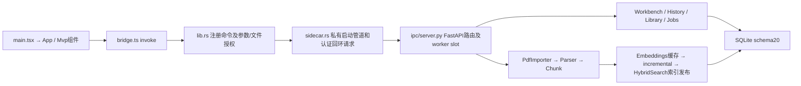

# CODE-CLEANUP 全仓库审查与等价重构

任务：CODE-CLEANUP / 2026-11-02；基线c3b6d8adc863a03935d60a28b0338d354a63124a；macOS arm64。开工工作区干净，独立开发分支codex/code-cleanup-20261102；用户后续改为验证后直接同步main、不创建PR；本报告随实际测试补全，不以历史报告代替当前验证。

## A. 清理前架构

已读取AGENTS、README、PLANS、SOURCE_PRIORITY、v0.10/v0.11契约及ADR-002/003/010/011。ADR-003的早期“未实施”是历史提案状态；当前sidecar.rs和server.py已经实施受认证回环通信。ADR-010的旧问答配额/逐请求授权由后续契约及ADR-011取代，不据旧文档改代码。

全仓跟踪文件1208项，静态模块图覆盖192个Python/TS/TSX/Rust文件；server.py有57个HTTP路由、lib.rs有53个Tauri命令。清单见本机evidence/CODE-CLEANUP/module-inventory.json。该图是import/注册证据，不是所有运行时调用都已遍历的证明。Python AST未发现8行以上完全相同函数体；参数/文字不同的重复仍需人工分析。

主要实际链路与边界：

- 导入：App.importFiles → bridge.importPdf → Rust文件选择/单次grant → /v0/imports或import-batches → PdfImporter.run。完成后App轮询调用prepareMvp → ipc/mvp.py按任务推进Parser与索引；不是前端直接访问PDF或SQLite。索引以Embeddings.space完整指纹和content_sha复用，经完整性校验发布，SQLite可见性仍权威。
- 问答：MvpAsk.submit → ask_question → /v0/answers → Workbench.create_answer/run_answer；系统意图分流、固定范围/版本校验、HybridSearch关键词/向量/RRF与结构候选、Provider输入收据、validate_quote/支持性检查、租约约束下保存。错误/拒答和历史不作新证据。此链算法不改。
- 会话：ConversationSidebar / MvpAsk → bridge conversation APIs → Rust固定路由 → History.manage_conversation/turns/index。删除检查同一事务内任务租约和研究引用；共享文献不级联。
- 模型：GenerationConnections → Rust原生凭据入口/固定命令 → ProviderRegistry；公开配置SQLite、密钥仅内存、revision/CAS与授权在每次外部请求重查。目录请求不是论文生成授权。模型选择器只允许受控目录grant。
- 持久化：Database按资源枚举迁移、旧版本先在线备份、BEGIN IMMEDIATE后复核版本；Jobs租约与恢复负责失联任务；backup_operations/service/backup分工处理任务、快照验证、独立恢复目录。现有20个迁移全部保留。

## B. 问题及分类

| 分类 | 文件/符号与证据 | 判断与风险 | 处理/验证 |
|---|---|---|---|
| A | App/main/bridge → lib.rs generate_handler → server.py装饰器路由 | 当前核心，不能按普通引用次数删动态入口；高风险 | 保留；Rust、集成及浏览器链路 |
| B | LegacyWorkspace.tsx、ResearchWorkbench、ProjectPicker、SourceSearch；ADR-010、mvp-v0.4明确兼容；Research路由/测试存在 | 主入口不加载Legacy不代表后端失效 | 保留；不删除共享CSS/后端 |
| D | lib.rs choose_generator_model/choose_ocr_model/choose_docling_model 三段目录选择/根目录围栏/grant/请求结构一致 | 重复安全流程容易单独演进；中风险 | 私有helper抽取，命令名/标题/purpose/path不变；Rust测试/Clippy |
| D | History.conversations/turns/index 重复limit+1投影和游标生成 | turns正文升序，但游标必须来自降序查询页；中风险 | 统一纯分页投影，详情映射仍在turns；同时间戳/项目/旧页测试 |
| D | TurnEvidence.version/page在两次find和渲染内多次JSON.parse | 大证据列表重复解析，坏历史需继续降级；低风险 | 每证据只解码一次，页有效性和缺失版本行为不变；降级分支审核+浏览器 |
| E | workbench.py 1549行、server.py1116行、lib.rs1458行（基线） | 规模大不证明全部可拆；scope警告的title字段在完整/分页接口不同 | 不合并不等价投影，不动检索生成事务；保留风险 |
| E | styles.css与studio.css叠加，动态状态class/旧工作台 | 静态类名搜索不足以证明选择器无用 | 不批量删CSS；响应式浏览器检查 |
| A/B | parsing/process、generator_worker、build_identity、__main__ | frozen分支、子进程模块及PyInstaller收集隐式使用 | 保留；冻结生命周期及Rust候选 |
| A/B | tools浏览器各阶段脚本、packaging、contracts/历史报告/specs/许可证 | CI、人工复现、契约/审计入口，不以未import判死 | 保留；检查配置和当前命令 |
| E | 可选sqlite-vec/LanceDB、OCR/Docling/Qwen依赖 | 当前设置/候选测试/打包flags确有调用，不能因默认未启用移除 | 锁文件不变，无安装/下载 |
| C | 未确认可安全删除的整文件或公开符号 | 不为凑删除量而断言无用 | 本次整文件删除0；重复实现通过D类抽取减少 |

## C. 已执行清理

1. Rust抽取私有choose_model_directory，三个命令仅提供固定标题、purpose及endpoint。保留spawn_blocking、对话框取消、路径转换、engine锁内工作区复核、目录grant、随机幂等键与所有错误映射；不将目录或请求路由暴露给前端。
2. History抽取_history_page，三个入口统一limit+1和游标编码；原SQL、事务、验证及项目过滤未改，turns仍只在显示时反转选定页。
3. TurnEvidence每条引用只解析一次anchor，复用页码/版本，替代重复page/version函数。非法JSON/null与无效页码仍降级；打开权限继续依据current_source_status，未改引用按钮。
4. 添加注释解释工作区选择竞态、游标降序与显示升序区别、anchor解析不授予来源访问权限。README改正已清理旧产物仍可启动的表述，不改写历史报告。
5. 新增实际数据库集成测试：空会话、同时间戳UUID排序、分页末尾游标和无重复/丢轮。没有删除整文件、公开符号、迁移或依赖，没有全仓格式化。

## D. 保留的历史功能

LegacyWorkspace和Research按上述明确兼容依据保留。SourceSearch仍含研究/旧工作台能力，DocumentDetails高级解析/表格、Lifecycle/Identity/Backup设置由当前设置或详情挂载。IPC路由、Tauri命令、迁移、冻结worker不能用全文搜索判死。历史报告保留原日期和结论；仅当前README启动说明如引用已清理旧app路径则更新说明。既有安全/科学门禁不随代码清理解除。

## E. 当前验证

原始日志位于本机忽略目录 `docs/engineering/evidence/CODE-CLEANUP/`；每条命令由tools/run_logged.py记录平台、argv、开始/结束时间、exit_code和输出。可提交验证索引只保留命令/计数/哈希，不上传原始运行日志或测试PDF。

| 命令 | 修改前 | 修改后 |
|---|---|---|
| `engine/.venv/bin/python -m pytest -c engine/pyproject.toml -q` | exit0，353 PASS/0 FAIL/0 SKIP | exit0，354 PASS/0 FAIL/0 SKIP |
| `engine/.venv/bin/ruff check --config engine/pyproject.toml engine/ragsystem tests` | exit0 PASS | exit0 PASS |
| `npm --prefix apps/desktop run build` | exit0 PASS | exit0 PASS（TS类型/未使用检查及Vite） |
| `.tools/cargo/bin/cargo test --locked --offline --manifest-path apps/desktop/src-tauri/Cargo.toml -- --include-ignored --test-threads=1` | exit0，10 PASS/0 FAIL/0 ignored | exit0，10 PASS/0 FAIL/0 ignored（新冻结侧车） |
| `.tools/cargo/bin/cargo clippy --locked --offline --manifest-path apps/desktop/src-tauri/Cargo.toml --all-targets -- -D warnings` | exit0 PASS | exit0 PASS |
| `pytest ... tests/integration/test_history_lifecycle.py tests/integration/test_conversation_management.py -q`（同Python/config前缀） | 全量已覆盖 | exit0，13 PASS/0 FAIL/0 SKIP |
| `node tools/browser_smoke.cjs`（CHAT_MANAGEMENT=1/source engine） | 本轮前未执行浏览器，不能引用旧验收当本轮基线 | exit0，46断言PASS；真实公开PDF/E5索引和实际Python，Tauri桥/生成模型为协议fixture |
| `packaging/build_sidecar.py --build-label CODE-CLEANUP --include-vector-lab --include-generation-lab --include-ocr-lab --include-docling-lab --output-directory .tools/build/CODE-CLEANUP-sidecar --evidence-directory docs/engineering/evidence/CODE-CLEANUP`（Python前缀） | CHAT-02侧车与基线99源文件一致 | exit0；新侧车99源文件SHA匹配修改后源码 |
| `pytest ... tests/integration/test_sidecar_lifecycle.py -q` | 全量内执行 | 复测exit0，4 PASS/0 FAIL/0 SKIP |
| `git diff --check`、迁移/契约/锁/算法文件及Tauri命令名比对 | 工作区干净 | PASS，无删除文件、无锁或迁移差异 |

全量涵盖用户点名的answer_pipeline、hybrid_workflow、conversation_management、single_provider、user_reported_questions、import_atomicity、backup_restore、vector_contract；模型资源均为本机已批准目录。Python/冻结使用RAGSYSTEM_MODEL_DIR、OCR_MODEL_DIR、DOCLING_MODEL_DIR及OCR_SCAN_PDF；Rust额外RAGSYSTEM_TEST_SIDECAR。全量修改后执行时使用CHAT-02旧冻结辅助进程，随后新冻结生命周期与Rust单独核验修改后产物，不能将前者冒充新冻结验证。

新增分页用例首轮12 PASS/1 FAIL：未完成上一轮便排队触发CONVERSATION_BUSY，属于新测试夹具流程错误。修正为真实run_answer逐轮完成后再验证分页，13项通过；没有修改并发保护、删除失败日志或放宽断言。既有Starlette弃用warning保留，未安装替代依赖。新冻结生命周期首轮3 PASS/1 FAIL：HTTP轮询失败任务时连接重置；运行时keep-alive为2秒且当时并发运行其他模型回归，时序/负载是待验证解释，不能据此认定根因。保留失败，执行独立复测，不修改生产超时或放宽断言。

功能覆盖：PDF导入/解析/索引、问答/系统信息、模型持久化、会话操作、自动滚动、PDF定位均有本轮浏览器或集成证据；备份/恢复/任务租约由完整Python/Rust覆盖。原生三个目录选择器的取消与切换窗口操作未进行GUI自动化；其重构等价性依据保持执行顺序的代码审查与编译，不能声称浏览器fixture覆盖原生对话框。

## F. 剩余风险

Windows干净安装、人工科研金标、真实1000篇和真实付费API未执行；本轮无付费请求、模型下载、用户文献外发或实际用户库写入。现有依赖安全门禁此前FAIL需单独修复，锁未变化不代表安全结论自动转PASS。隐藏工作台缺乏完整原生UI验收；复杂模块的大拆分需单独设计和覆盖。静态图与选定实际链路审查不宣称形式化证明全仓无死代码。

## G. 变更与提交

用户后续明确要求直接main、不创建PR，覆盖附件原交付要求。逻辑提交分为等价代码重构及审查文档；最终推送前再次fetch并确认可快进，不强推。最终统计与SHA由提交记录/验证索引记录。

验证命令索引：[CODE-CLEANUP-validation.json](CODE-CLEANUP-validation.json)。本轮不执行真实云模型请求；当前开发.app未重新打包，仅构建冻结引擎用于测试。

最终功能回归：PASS。真实Windows安装：NOT EXECUTED；科研金标：NOT EXECUTED。无新增ADR、无架构/协议/数据库行为变更。最终新增3文件、修改6文件、删除0文件；生产代码与测试合计+87/-52行（净+35），其中生产代码净+8、测试+27；其余为计划、审查报告、命令索引和README说明。不是以减少总代码行数衡量清理成果。

提交分为 `refactor: deduplicate model selection, history paging and evidence decoding` 与 `docs: record repository cleanup audit and regression evidence`。用户已批准直接main交付；本地关键回归已通过，随后普通快进并推送main，最终远端SHA与工作区核验存于本机evidence/CODE-CLEANUP/delivery.json，不创建PR、不强推。
