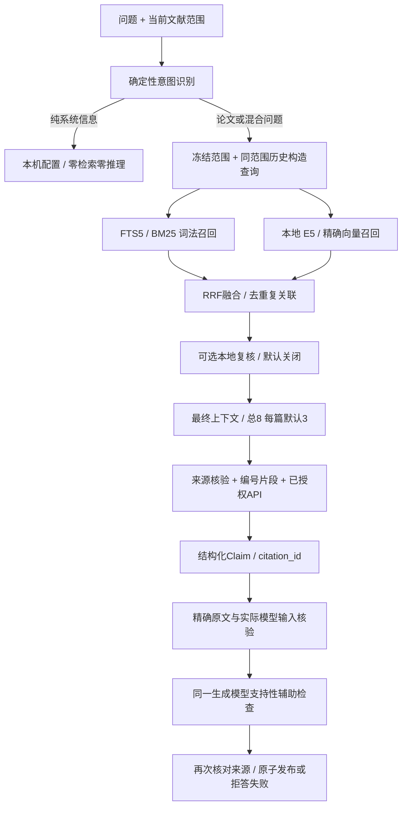

# RAG-02 API问答全链路检查与企业/开源对照

Task ID / 阶段：RAG-02 / P2–P3本地优化，2026-10-27起、2026-10-28交付（Asia/Shanghai）。
范围和实际变更文件：意图/查询、短语召回、有界复核、模型输入/来源边界、阶段诊断、评估与文档；文件见§9。
需求与契约对应章节：用户当前全链路检查/优化及企业/GitHub参考指令；v1.1 §§3、4.3–4.5、6、7、9；retrieval-answer-v0.7继承v0.6。
已执行命令、平台、退出码、日志位置：macOS26.2 arm64、16GiB/10逻辑CPU；命令/UTC时间/退出码/原始SHA见RAG-02-validation.json及§5。
功能测试：PASS（本机工程范围）；Python最终297通过/0失败/0跳过，Rust6通过/3 ignored，TS/Vite、Ruff、静态kit、浏览器88检查通过。
真实 Windows 安装测试：BLOCKED（缺干净目标机）。
科研质量测试：BLOCKED（0人工裁定样本、阈值待批准；真实收费API/生成质量本轮NOT EXECUTED）。
关键发现/未解决的问题：见§3/§7；工程边界已修，不能以合成排序分数、协议Fixture或真实E5小样本宣布语义质量合格。
与方案不同的设计及 ADR 编号：无主架构/依赖/schema/验收门槛变化，无新增ADR；有界review预算和模型输入增量在v0.7明确版本化。
下一步及是否需要人工批准：可继续现有授权内本地工作；启用新模型/付费API/论文外发、发布及正式质量门禁需对应明确批准。本轮未提交或推送。

## 1. 基线与结论范围

已确认：开始时main/b47fa877fb6c7b07f3e95fdfa0ebd5bcf9df996b，工作区干净。阅读当前AGENTS、PLANS、RAG-01计划/报告、v0.6契约和真实调用代码后启动。本轮基础pytest269通过/13跳过，无失败；跳过项在最终显式提供已有E5/OCR/Docling与新冻结侧车后全部补跑。没有用上轮282通过替代本轮基线。

用户追加“参考其他企业或者GitHub项目”后，检查官方文档和LlamaIndex源码。外部实现是设计参考，不替代本仓库业务/科研约束；未安装这些框架、不下载新模型、不改变SQLite/FTS5/E5/精确向量/RRF，不上传用户PDF/源代码或调用真实收费API。所有API测试均为隔离工作区与loopback协议Fixture。

## 2. 当前项目如何通过API回答

图是逻辑分支，当前HybridSearch实现顺序执行两路召回，没有声称已并发。

实际入口：MvpAsk.submit → bridge.askQuestion → Rust ask_question → 本地鉴权POST /v0/answers → Workbench.create_answer（Provider授权/版本与解析快照/持久任务）→ run_answer → HybridSearch/Sources → GenerationService/Provider → 引文/来源/人工状态持久化 → 轮询历史/UI。

**API模型不连接本地知识库。** 检索先在本机完成，随后POST配置的`/chat/completions`，`stream=false`，发送当前论文问题、仅限同范围的有界历史和编号excerpts。每条excerpt含原文、当前P/V标签、保存题名、真实页码与部分截取说明；不发送完整PDF、文件路径或凭据正文。Key留在引擎进程内存，由Provider构造认证头。支持检查沿用已验证的chunk_id/quote输入，Chunk ID是不透明关联ID，不是文件地址。

回答模型返回`claims[{text,evidence:[{citation_id}]}]`，Python把编号还原为确定的原文片段。随后每条Claim向同一Provider发一次support检查；仅supported草稿可作为回答展示，uncertain/contradicted保留状态与提示。普通生成通常1次回答+每条Claim 1次支持检查；服务端最多接纳6条Claim，提示要求最多2条。没有命中、摘录模式或纯系统信息不调用回答模型。手动获取模型目录/连接探测是独立操作，本轮未新增每问题自动探活或重试。

**来源可核验不等于结论已科学验证。** 同模型support不是独立事实核查；科研支持、实验可比性和人工状态继续独立保存。

## 3. 官方项目对照与本项目决策

| 官方参考 | 已核对的做法 | 本轮应用 / 限制 |
|---|---|---|
| [Dify Knowledge Pipeline](https://www.dify.ai/blog/introducing-knowledge-pipeline) | 阶段执行可观察，变量/元数据/引用随知识链路流转 | 加入阶段trace与可展开诊断，补片段来源/页/输入审计；不安装Dify或改变桌面架构 |
| [RAGFlow Search Settings](https://ragflow.io/docs/v1.0.0-rc2/search_settings) | 重排候选规模和结果数量分别控制，阈值影响漏检与噪声，模型重排有延迟代价 | 重排移到最终截断前，池≤12/每批≤6，最终8/每篇3；默认关闭，跨批分数未校准 |
| [Haystack DocumentJoiner](https://docs.haystack.deepset.ai/docs/3.1/documentjoiner)、[Retriever接口](https://docs.haystack.deepset.ai/reference/3.3/retrievers-api) | 通道列表融合，区分每路Top K与融合结果Top K | 保留每路50/原始rank/RRF、最终上下文独立，记录召回耗时；并发召回需另测一致性和目标平台成本 |
| [LlamaIndex QueryFusion文档](https://developers.llamaindex.ai/python/framework/integrations/retrievers/reciprocal_rerank_fusion/)、[源码](https://github.com/run-llama/llama_index/blob/main/llama-index-core/llama_index/core/retrievers/fusion_retriever.py) | 保留原查询，额外查询生成是独立LLM调用，可设num_queries=1关闭 | 本轮如实标记确定性查询构造，没有默认增加LLM翻译/HyDE/多查询费用；相关增益需同范围金标比较 |

检查日期为2026-10-27—28；链接中的main/在线文档可能后续变化，未声称对应框架版本已安装或由本项目实测通过。参考说明为本报告的简述，没有复制外部源码。

不能照抄阈值：当前两通道1-based RRF理论上限`2/(60+1)=0.0327869…`。RAGFlow文档中的0.2相似度阈值属于另一套综合评分；直接拿它过滤本项目RRF会清空结果。任何阈值、专用Reranker或重排默认开启建议都需按本项目分数和人工集校准。

## 4. 复现的问题与实际修复

| 环节 / 根因 | 修复 | 关键验收 |
|---|---|---|
| 复合意图用“并”和and全局split再用分号拼接，破坏“并行”、模型比较和参数标点 | 捕获分隔符，仅去掉完整系统子句和连接词，保留科研内部原文 | “你是什么模型？并解释并行训练与BERT and GPT…”保留科研部分；纯科研不被短路 |
| 相同会话可切换论文，但历史不校验版本/解析/身份，向API带入旧范围问题 | 仅连续相同项目/版本/逻辑论文/PDF SHA/解析批次补历史；范围切换立即断链 | 新范围API history=[]，当前查询不混入旧论文词；英文非指代it不加历史 |
| 所有关键词OR召回，显式短语被包含更多问句词的干扰段排到后面 | 引号词元短语先召回，多短语AND，再用OR补足；保留各阶段BM25/rank | 合成“alpha beta”精确词序段优先，反序问句噪声保留为扩展；不改原文索引和偏移 |
| 本地review只处理已截断到最终8/每篇3的池，无法救回后续候选 | 保留原上下文作为种子，补不同内容至12，最多2批6条，排序后再执行最终配额 | 原排名第10候选通过受控fixture进入最终结果，最终单篇≤3；不是Qwen质量结论 |
| 只在发布前核对来源，检索后撤稿仍可能先发回答/支持请求 | 首次推理前核验来源；每次调用/网络边界重查租约、授权和冻结范围 | 检索后撤稿首个模型POST=0；回答后撤稿只保留已发生1个POST，不再发support |
| 模型看不到片段所属论文/页，长片段前缀截取缺审计 | 本地/网络共用编号片段格式，P/V分组/页/题名白名单、原/实字符数和partial标志 | 两类Provider输入一致，不发送source里的任意路径/Key；usage缺失为null |
| 引文只校验“属于检索池”，未限定实际模型输入 | included IDs及真实前缀长度形成额外quote_pool | 被预算移除的Chunk、同Chunk未送出尾部都拒发；无后续support和部分引用记录 |
| 只有总结果，不能定位查询/召回/模型失败；第一条模型记录可能是reviewer | 阶段耗时/数量/模型尝试持久化，UI可展开；标题读取generation阶段 | 失败阶段标failed，零模型步骤为0；UI不将Qwen复核冒充回答API模型 |

默认检索策略没有增加模型调用。显式review的2批0–5意见属于有界实验，跨批校准、上下文位置偏差和真实效果未知；不能当成专用Cross-Encoder。显式引号策略仅有合成反例与工程回归支持，不宣称对所有自然语言查询更好。无引号OR/BM25、E5前缀/归一化/溢出拒绝、精确向量及RRF公式保持。

本地prompt升级v12、网络v4；旧v9/v10/v11仅允许提示字段迁移，其他权重/运行时不符继续拒绝。最终数据库、三份锁和Embedding空间不变，没有重建用户库或重编码用户资料。

## 5. 真实执行记录

原始记录包含argv、平台、UTC起止时间、cwd、退出码和完整输出，保留于本机`docs/engineering/evidence/RAG-02-2026-10-27/`。目录沿用任务开始日，交付日期按Asia/Shanghai为10月28日。摘要/哈希/参考URL见[RAG-02-validation.json](RAG-02-validation.json)；不上传原始PDF/模型/用户库/密钥/截图。

| 标签 | 退出码 | 结果 | 原始记录 |
|---|---:|---|---|
| S00-python | 0 | 269 passed, 13 skipped, 1 warning in 50.28s | [JSON](../evidence/RAG-02-2026-10-27/20261027T154842810587Z-S00-python.json) |
| S01-before | 1 | 执行失败（见原始记录） | [JSON](../evidence/RAG-02-2026-10-27/20261027T160701446097Z-S01-before.json) |
| S02-query-and-phrase | 1 | 2 failed, 35 passed, 1 warning in 5.14s | [JSON](../evidence/RAG-02-2026-10-27/20261027T160856661326Z-S02-query-and-phrase.json) |
| S02-scope-after | 0 | 40 passed, 1 warning in 6.77s | [JSON](../evidence/RAG-02-2026-10-27/20261027T160950843697Z-S02-scope-after.json) |
| S03-before-context | 2 | BLOCKED（原始记录为准） | [JSON](../evidence/RAG-02-2026-10-27/20261027T161732853199Z-S03-before-context.json) |
| S03-context-after | 1 | 1 failed, 44 passed, 1 warning in 13.08s | [JSON](../evidence/RAG-02-2026-10-27/20261027T162003479038Z-S03-context-after.json) |
| S04-core | 0 | 89 passed, 1 warning in 18.19s | [JSON](../evidence/RAG-02-2026-10-27/20261027T162205982433Z-S04-core.json) |
| S04-ruff | 1 | 执行失败（见原始记录） | [JSON](../evidence/RAG-02-2026-10-27/20261027T162520497141Z-S04-ruff.json) |
| S05-ui-build | 0 | ✓ built in 124ms | [JSON](../evidence/RAG-02-2026-10-27/20261027T162604790106Z-S05-ui-build.json) |
| S05-full-python | 0 | 282 passed, 13 skipped, 1 warning in 53.30s | [JSON](../evidence/RAG-02-2026-10-27/20261027T162605552652Z-S05-full-python.json) |
| S05-excerpt-boundary | 0 | 13 passed, 1 warning in 3.18s | [JSON](../evidence/RAG-02-2026-10-27/20261027T162828085028Z-S05-excerpt-boundary.json) |
| S06-static | 0 | All checks passed! | [JSON](../evidence/RAG-02-2026-10-27/20261027T162923633780Z-S06-static.json) |
| S06-browser | 0 | BROWSER_UI_SMOKE: PASS; real engine process, simulated Tauri transport; not native/Windows acceptance | [JSON](../evidence/RAG-02-2026-10-27/20261027T163047334149Z-S06-browser.json) |
| S06-resources | 0 | 295 passed, 1 skipped, 1 warning in 103.15s (0:01:43) | [JSON](../evidence/RAG-02-2026-10-27/20261027T163048491472Z-S06-resources.json) |
| S07-evaluator | 0 | 17 passed, 1 skipped, 1 warning in 1.30s | [JSON](../evidence/RAG-02-2026-10-27/20261027T164422554025Z-S07-evaluator.json) |
| S07-freeze | 0 | 执行成功（见原始记录） | [JSON](../evidence/RAG-02-2026-10-27/20261027T164423639876Z-S07-freeze.json) |
| S08-ui-final | 0 | ✓ built in 113ms | [JSON](../evidence/RAG-02-2026-10-27/20261027T165021996244Z-S08-ui-final.json) |
| S08-browser-final | 0 | BROWSER_UI_SMOKE: PASS; real engine process, simulated Tauri transport; not native/Windows acceptance | [JSON](../evidence/RAG-02-2026-10-27/20261027T165022644194Z-S08-browser-final.json) |
| S08-python-final | 0 | 297 passed, 1 warning in 107.11s (0:01:47) | [JSON](../evidence/RAG-02-2026-10-27/20261027T165022644194Z-S08-python-final.json) |
| S08-rust-final | 0 | test result: ok. 0 passed; 0 failed; 0 ignored; 0 measured; 0 filtered out; finished in 0.00s | [JSON](../evidence/RAG-02-2026-10-27/20261027T165022646363Z-S08-rust-final.json) |
| S08-static | 0 | All checks passed! | [JSON](../evidence/RAG-02-2026-10-27/20261027T165510975880Z-S08-static.json) |
| S08-kit | 0 | STATIC KIT VALIDATION: PASS (files and syntax only) | [JSON](../evidence/RAG-02-2026-10-27/20261027T165511072808Z-S08-kit.json) |
| S09-real-capacity-gate | 2 | BLOCKED（原始记录为准） | [JSON](../evidence/RAG-02-2026-10-27/20261027T165815895268Z-S09-real-capacity-gate.json) |
| S09-scientific-gate | 2 | BLOCKED（原始记录为准） | [JSON](../evidence/RAG-02-2026-10-27/20261027T165815895268Z-S09-scientific-gate.json) |

失败没有删除：S01新增用例8项均先失败；修复意图/历史/短语后仅剩2个来源调用边界失败，补外发前复查后通过。S03新格式器不存在时collection失败保留，随后实现；扩大review池后，原来“3条完全反序”的断言不再适合12条两批0–5分，改为独立明确的12条同分稳定序列/最终3段断言，没有删除配额、无Claim或来源断言。旧prompt测试扩充v11→v12并保留权重变化拒绝；一次导入排序Ruff失败已修复。

最终297项pytest使用已有E5/OCR/Docling及新冻结侧车，0失败/0跳过；既有FastAPI TestClient/httpx弃用warning保留，无擅自依赖安装。Rust6通过/3 ignored，对应最小侧车传输/生命周期；3项完整候选包用例未执行，不按PASS。最小冻结产物`.tools/build/RAG-02-final-sidecar/ragsystem-engine-aarch64-apple-darwin`，SHA256 `cd4a4e6d64cf22d03454906939cde4cce6f42dbb888d0ad007627b489c4710a0`，源码输入哈希匹配；未覆盖用户默认完整侧车或创建发行包。

TS/Vite/Ruff/静态kit通过。浏览器88检查使用真实源码引擎/公开PDF及loopback模型fixture、模拟Tauri传输；检查新诊断、实际模型输入数、来源字段、混合科研文本、凭据/备份/本轮来源等。已目视核对`browser-final/C-pipeline.png`布局，时间是fixture工程执行时间，不是实际大模型延迟。原生IME/文件对话框/Windows不据此通过。

## 6. 实测与暂不可验证的信息

真实E5执行实验：1篇已许可BERT PDF、两个未标注问题、每策略2次，共12行；全部共享冻结范围。原始`real-pdf-strategy-comparison-final.json`：

| 策略 | N | P50 ms | P95 ms | Recall/MRR/nDCG |
|---|---:|---:|---:|---|
| keyword | 4 | 2.782 | 3.394 | null（未标注） |
| vector_exact | 4 | 21.777 | 512.298 | null（未标注） |
| hybrid | 4 | 23.074 | 23.284 | null（未标注） |

含查询编码/检查/关联，首个向量样本含冷加载，顺序为keyword→vector→hybrid；不能用上述小样本冷热差异给策略排优劣、推断SLA或千篇性能。新timings_ms可定位词法、向量、映射、融合与上下文耗时，pipeline_trace可定位模型阶段。真实API端到端P50/P95本轮NOT MEASURED。

已确认：离线科研门禁exit2/BLOCKED，0人工样本、阈值pending，质量指标不计算。真实容量门禁exit2/BLOCKED：许可manifest仅2篇，要求1000篇。没有伪造人工标注、独立事实/支持、引用准确率、无支持率或拒答质量数字。

合理推测/待测：浏览器公开PDF的关键词候选中可见图示token串和参考文献内容，可能影响此类自然语言问题的支持性。它说明检索命中和完整引用链不能替代问题相关性/语义支持评测；没有将截图中fixture的supported判定当科学结论。章节权重/参考文献降权、重排校准、中文OR噪声、跨语言与连续追问应纳入合法人工金标负例；未凭截图拍定一个新的全局降权规则。

## 7. 风险、回退与未完成门禁

- 用户原件/批注/审查/历史/模型配置不删不覆盖；无schema迁移、模型/依赖下载或架构替换。源码可回退；旧程序对新提示指纹可能需要重新校验已有资源，不删库。
- 本地题名是元数据，P/V仅当轮分组；SourceAnchor仍页级，没有虚构区域高亮。模型支持为辅助意见，人工状态独立保留。
- 确定性清单/指代规则有语言边界，未声称通用意图理解。LLM同义改写/翻译/多查询、Parent-child/ANN/复杂Agent仍需独立证据与范围评审。
- review默认关闭；两批分数不可视为统一校准相关性，更不能当科学可信度。额外本地延迟和真实增益待测。
- 真实付费API、独立科研金标、真实1000篇/重复来源大载荷、完整原生与干净Windows安装未验收；发行签名/公证/依赖再分发门禁不变。

建议继续本地工程/金标准备；正式科研/平台/发布NO-GO。取得合法目标语料、人工裁定及批准阈值后，用相同范围/候选/评价口径比较，再决定是否启用重排、多查询或改变召回策略。当前改动保留工作区，未提交/推送。

## 8. 数据流与失败状态对应

纯系统→system_info、无文献/模型调用；无命中→refused/no_hits；有候选但无受支持草稿→refused/insufficient_evidence；检索失败→retrieval_failed；生成、来源或引用检查失败→failed/generation_failed及具体failure_stage/error_code。任何失败不发布部分Claim/Evidence，trace保留已执行步骤，历史人工审查不被新生成覆盖。Pipeline的调用尝试不代表成功请求/费用，usage仅保留接口实际返回值。

## 9. 本轮文件

- `PLANS.md`
- `README.md`
- `apps/desktop/src/bridge.ts`
- `apps/desktop/src/components/MvpAsk.tsx`
- `apps/desktop/src/components/PipelineDiagnostics.tsx`
- `contracts/README.md`
- `contracts/retrieval-answer-v0.6.md`
- `contracts/retrieval-answer-v0.7.md`
- `docs/engineering/deferred-tests.md`
- `docs/engineering/execplans/RAG-02-reference-pipeline.md`
- `docs/engineering/reports/RAG-02-2026-10-28.md`
- `docs/engineering/reports/RAG-02-validation.json`
- `docs/evaluation/goldset-protocol.md`
- `engine/ragsystem/models/generation_service.py`
- `engine/ragsystem/models/local_generator.py`
- `engine/ragsystem/models/network_provider.py`
- `engine/ragsystem/models/provider.py`
- `engine/ragsystem/retrieval/hybrid.py`
- `engine/ragsystem/retrieval/reranking.py`
- `engine/ragsystem/retrieval/source_search.py`
- `engine/ragsystem/retrieval/tokenizer.py`
- `engine/ragsystem/workflows/diagnostics.py`
- `engine/ragsystem/workflows/system_information.py`
- `engine/ragsystem/workflows/workbench.py`
- `tests/integration/test_pipeline_refinements.py`
- `tests/integration/test_retrieval_comparison.py`
- `tests/integration/test_round2_providers.py`
- `tests/integration/test_workbench.py`
- `tests/unit/test_excerpt_context.py`
- `tools/browser_mvp03_routing.cjs`
- `tools/compare_retrieval.py`
