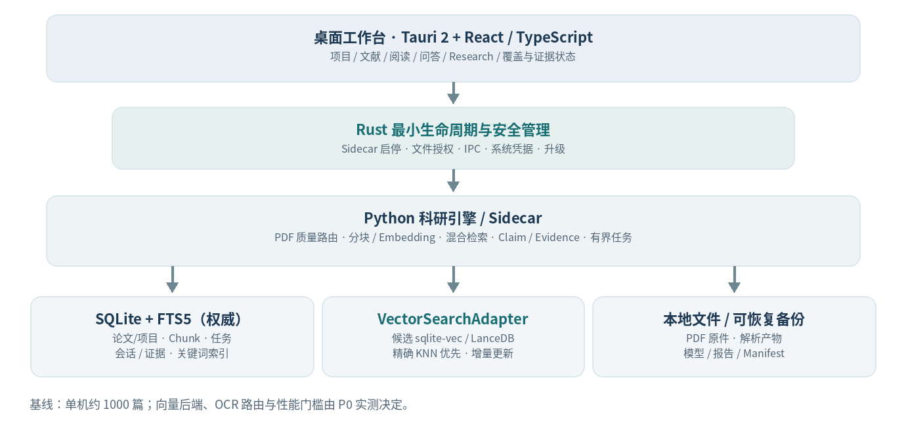
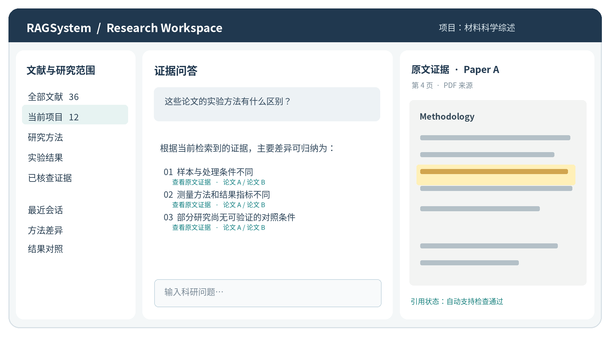

**RESEARCH SOFTWARE / ARCHITECTURE PROPOSAL**

**RAGSystem 2.0**

**完整产品与技术设计方案**

Windows 原生科研工作台 · 约 1000 篇科研论文 · 本地优先 · 可追溯证据

<table>
<colgroup>
<col style="width: 100%" />
</colgroup>
<thead>
<tr class="header">
<th>
<strong>设计定位</strong>

面向约 1000 篇科研论文的 Windows 单用户本地优先桌面应用。以可维护、可检索、可复核为第一目标；保留未来扩展空间，但不预置企业级服务与不必要的独立数据库。
</th>
</tr>
</thead>
<tbody>
</tbody>
</table>

**文件版本 v1.1 / 千篇级规模适配修订稿**

**修订日期 2026-10-23**

**目标平台** Windows 11 x64 优先

**主要读者** 产品负责人、架构师、研发人员、测试负责人

**决策边界 确定基础能力；向量引擎、解析路由与性能门槛以 P0 实测决策**

# 执行摘要

本方案将 RAGSystem 2.0 定义为面向约 1000 篇论文的“本地优先、证据驱动的个人科研工作台”。一个 Windows 安装程序完成部署，导入 PDF 后进行可恢复的解析、增量索引与持久化存储；科研问答应能点击返回原文，跨论文任务必须说明检索与提取覆盖范围。所有技术容量与性能数字均属待验证设计假设，不是实测结果。

## 核心决策速览

| 领域           | 建议基线                                                 | 决策状态                |
|----------------|----------------------------------------------------------|-------------------------|
| **应用形态**   | Windows 11 x64 单用户桌面；安装 EXE，无 Docker / WSL     | 确定方向                |
| **界面与运行** | Tauri 2 + React + Rust 最小生命周期管理 + Python Sidecar | 需真实 Windows 安装验收 |
| **权威数据**   | SQLite WAL + 不可变 PDF / 解析产物；项目-论文多对多      | 确定方向                |
| **关键词检索** | FTS5 + 版本化中文预分词与术语规则；trigram 按需          | 质量评测后定配置        |
| **向量检索**   | 统一检索接口；sqlite-vec 与 LanceDB 精确 KNN 同台测试    | P0 测试后锁定           |
| **文献解析**   | PDFium 快速提取 + 质量评分 + Docling/OCR 条件路由        | 需真实 PDF 基准测试     |
| **检索路线**   | 局部问答：混合检索；全集研究：论文级覆盖和逐篇提取       | 确定产品原则            |
| **模型与任务** | 本地 Embedding；生成云/本地可选；SQLite 简化持久任务     | 需性能和打包验证        |
| **科研可信性** | 来源有效、语义支持、科学可比三层审查；人工复核独立       | 确定产品原则            |

## 交付优先级

P0 首先证明“原生安装 → 真实论文解析 → 两种向量后端基准比较 → 持久增量索引 → 源文定位”。之后再完成混合检索、可信问答与覆盖型 Research；不因 1000 篇规模预设复杂 ANN、多 Agent 或跨库事务基础设施。基础安装不内置重量级生成模型。

<table>
<colgroup>
<col style="width: 100%" />
</colgroup>
<thead>
<tr class="header">
<th>
<strong>重要说明</strong>

本版新增的“1000 篇规模估算”和性能目标是明确假设及拟验收门槛，并非实际压测结论。sqlite-vec、LanceDB、PDFium、Docling 和模型的最终版本需通过干净 Windows 安装、真实语料评测、恢复测试及许可审查；不得以设计稿替代验证证据。
</th>
</tr>
</thead>
<tbody>
</tbody>
</table>

## 目录

> 01 产品定位与范围
>
> 02 从零开发的总体架构
>
> 03 数据体系与向量持久化
>
> 04 文献导入、检索与模型
>
> 05 前端 UI 与交互规范
>
> 06 科研证据与 Research 工作流
>
> 07 任务调度、运行时与异常恢复
>
> 08 安装、隐私、备份与升级
>
> 09 测试评测与发布门禁
>
> 10 开发路线、工程任务及风险
>
> 11 开源参考、版权与许可边界

附录 A v1.1 核心变更及待决事项

# 01 产品定位与范围

## 1.1 用户与目标

核心用户为 Windows 个人科研人员、研究生与实验室助理；初期知识库目标约 1000 篇科研论文，允许在不迁移服务架构的前提下增长至数千篇。用户主要任务是管理论文、定位方法与实验结果、进行授权范围内的问答、跨论文比较以及人工复核后的结构化综述。

## 1.2 用户获得的价值

> • 独立安装：无需 Docker、WSL、PostgreSQL、Redis、Python、Node.js 或命令行。
>
> • 资料可控：原件、索引与报告本机保存，允许配置资料目录；云端请求范围与费用可见。
>
> • 可核查回答：来源 ID 可回到准确论文版本、页面、原文片段或表格单元，并显示定位可靠度。
>
> • 有边界的 Research：不将模型审查当作人工证实；缺失字段和不可比实验明确标识。
>
> • 失败可恢复：断电、崩溃、索引中断后可安全继续或重建，不丢失文献原件。

## 1.3 初期不做什么

第一版不做多人协作、在线账户同步、插件市场、科研社交网络、自动写作投稿、联网自动抓取所有出版社全文，也不以“完全离线大模型”作为最低安装要求。macOS/Linux 在架构上保留扩展可能，但优先完成 Windows 11 x64。

## 1.4 核心用户旅程

<table>
<colgroup>
<col style="width: 100%" />
</colgroup>
<thead>
<tr class="header">
<th>下载安装 EXE → 创建项目 → 导入 1–N 篇 PDF 
→ 确认解析 / 索引状态 → 选择文献范围并提问 
→ 检查 PDF 原文证据 → 归档证据与笔记 
→ 深入研究：证据矩阵 → 人工复核 → 生成报告</th>
</tr>
</thead>
<tbody>
</tbody>
</table>

## 1.5 不可妥协的科研原则

> • 记忆不是证据：聊天历史、用户指令和模型草稿不能替代已检索原文。
>
> • 引用必须有来源：每个证据 ID 能追溯到特定文档版本与具体内容范围。
>
> • 自动审查不是事实证明：语义审查结果必须和人工确认状态分开。
>
> • 证据不足时拒答或明确限定结论，不补造方法、数据或实验结果。
>
> • 跨论文比较必须说明覆盖范围、失败论文、数据集/单位/实验条件；禁止以 Top-K 结果冒充穷尽搜索。

• 不可信输入边界：论文正文属于外部数据，不能要求系统执行命令、访问凭据或越权调用工具。

# 02 从零开发的总体架构

## 2.1 架构总览

图 1 · 修订架构：SQLite 保存业务真值；向量后端通过适配层选择，论文原件与索引持久落盘。

## 2.2 模块责任边界

| 模块                    | 责任                                                          | 不承担                       |
|-------------------------|---------------------------------------------------------------|------------------------------|
| **Tauri / Rust**        | Sidecar 生命周期、文件授权、凭据、更新、单实例、最小 IPC      | 科研论断生成、业务索引规则   |
| **React UI**            | 文献与项目、阅读、证据卡、覆盖状态、报告编辑                  | 直接操作数据库、持有 API Key |
| **Python 引擎**         | 解析路由、分块、Embedding、混合检索、证据、评测、受控任务     | 任意系统 Shell 与未授权联网  |
| **SQLite / FTS5**       | 论文/项目/Chunk/任务/证据/全文索引的业务真值                  | 存储大量 PDF 二进制          |
| **VectorSearchAdapter** | 统一 upsert/delete/search/rebuild；sqlite-vec 或 LanceDB 候选 | 决定科研结论的正确性         |
| **文件存储**            | PDF 原件、解析中间产物、模型、报告、备份 Manifest             | 单独决定证据是否有效         |

## 2.3 进程模型和本地通信

桌面启动时由 Rust 创建一个受控 Python Sidecar 进程并监测存活；简单任务由 Sidecar 内有限 Worker 执行。仅通过授权的本地 IPC 访问限定 API，优先命名管道或带会话令牌的随机回环端口。不得开放无认证端口或任意 Shell 权限；UI 和 Python 进程都不得从 PDF 文本中获取执行命令的授权。

## 2.4 运行时选型门禁

> • 在无开发工具、无 Docker/WSL 的干净 Windows 11 x64 上验证完整 Sidecar 打包。
>
> • 验证中文用户名、中文/空格路径、非管理员账户、WebView2 依赖与 Windows Defender 常见配置。
>
> • 冻结需要的本机 DLL、运行时、许可文件；不得仅靠 CI 预装开发环境宣布产品就绪。
>
> • SQLite / FTS5 / sqlite-vec 与 LanceDB 候选、PDFium / Docling 必须在同一真实安装产物验证；不要求所有候选随最终发行版同时安装。

# 03 数据体系与向量持久化

## 3.1 向量是否需要永久保存？

需要。Embedding 必须独立于可重建的检索索引长期保存；重启软件不重算整个文献库。查询通常只计算问题向量，新增论文只向量化新增或内容变化的 Chunk。索引结构是否额外建持久化 ANN，必须视精确检索实际延迟决定。

容量示例（待真实文献清点）：1000 篇 × 平均 20 页 × 每页 2–4 Chunk ≈ 4–8 万 Chunk。768 维 Float32 向量约 117–234 MiB；1024 维约 156–313 MiB，均不含元数据、索引、WAL 与模型权重。若 PDF 平均 2–5 MB，原件约 2–5 GB；扫描件可能远大于此。规模测算不能代替实际页数、文字量、图片/表格比例和扫描比例统计。

| 对象                           | 保存与复用策略                               | 更新触发条件                 |
|--------------------------------|----------------------------------------------|------------------------------|
| **PDF 原件与 SHA256**          | 不可变；同一文件哈希去重                     | 导入新的文件版本             |
| **论文元数据与关联**           | 论文逻辑实体与多个文件版本、项目成员关系分离 | 元数据或项目归属变化         |
| **ParseRun / Element / Chunk** | 记录解析、切块配置及文本/坐标映射            | 页面变化或算法版本升级       |
| **EmbeddingRecord**            | 按内容哈希 + 模型完整指纹复用向量            | Chunk 内容或模型/预处理变化  |
| **VectorIndex（可选）**        | 由 EmbeddingRecord 生成并持久化              | 向量增删、损坏或索引配置变化 |
| **FTS5 / 查询向量**            | 全文索引随 Chunk 维护；查询向量可短期缓存    | 文本/分词规则变化；新查询    |

## 3.2 Embedding、索引世代与增量更新

将 EmbeddingSpace（模型名称/版本、权重哈希、维度、距离度量、归一化与预处理配置）和 EmbeddingRecord（Chunk 内容指纹、空间 ID、向量引用、状态）独立于 VectorIndex。只有更换向量空间或执行全量重建时使用 IndexGeneration 的 STAGING → ACTIVE → RETIRED 发布；日常新增 1–N 篇文献只做受影响 Chunk 的幂等 upsert/delete，不全量生成新世代。删除先撤销可见性，再异步清理衍生向量与索引；旧索引仅在全量切换时保留。

<table>
<colgroup>
<col style="width: 100%" />
</colgroup>
<thead>
<tr class="header">
<th>Document 1 ── N DocumentVersion 1 ── N Element / Chunk 
Project N ── N Document DocumentVersion ── N FileAsset 
Chunk 1 ── N EmbeddingRecord N ── 1 EmbeddingSpace 
EmbeddingRecord ── IndexGeneration（仅重建发布时关联） 
Claim N ── N EvidenceSpan N ── 1 DocumentVersion</th>
</tr>
</thead>
<tbody>
</tbody>
</table>

## 3.3 向量后端与一致性边界

向量访问封装为 VectorSearchAdapter（upsert、delete、search_exact、check_integrity、rebuild）。方案 A 为 SQLite + sqlite-vec，优先验证单库备份与更新语义；方案 B 为 SQLite + LanceDB，绝不能假设跨库原子事务。两方案均以 SQLite 的文献/Chunk、任务及可见性标记为权威来源：先持久化任务、幂等写向量、校验数目/维度/Chunk ID 后发布可检索状态；异常重启逐项对账、补写或撤销。索引损坏先尝试由已保存向量重建，不默认重算 Embedding。

## 3.4 主要实体

| 领域     | 核心实体                                                         | 关键约束 / 字段                                           |
|----------|------------------------------------------------------------------|-----------------------------------------------------------|
| **资料** | Document, DocumentVersion, FileAsset, ProjectDocument            | DOI/题名/作者、文件 SHA256、论文版本、项目多对多          |
| **解析** | ParseRun, Element, Chunk, SourceRegion                           | 解析器版本、text_offsets、page/bbox、alignment_confidence |
| **索引** | EmbeddingSpace, EmbeddingRecord, IndexGeneration                 | 完整模型指纹、内容哈希、维度、距离度量、发布状态          |
| **任务** | Job, JobAttempt, Event                                           | 幂等键、心跳、租约、取消、重试、错误码                    |
| **会话** | Conversation, Message, Run, ScopeSnapshot                        | 本轮允许文献集合、提示词/模型版本、结果引用               |
| **科研** | EvidenceSpan, Claim, Verification, HumanReview, StudyObservation | 源文位置、语义支持、实验条件、人工状态分离                |
| **成果** | EvidenceMatrix, ReportRevision, Annotation                       | 变更历史、纳入证据、覆盖率、过期来源警示                  |

## 3.5 存储目录与备份

<table>
<colgroup>
<col style="width: 100%" />
</colgroup>
<thead>
<tr class="header">
<th>默认数据根目录：%LOCALAPPDATA%\RAGSystem\（首次配置后可迁移） 
data\research.db papers\&lt;sha256&gt;.pdf parsed\&lt;doc-version&gt;\ 
vectors\&lt;embedding-space&gt;\ # 仅 LanceDB/独立向量目录方案 
models\embedding\ reranker\ optional-llm\ 
reports\ backups\ logs\ manifests\</th>
</tr>
</thead>
<tbody>
</tbody>
</table>

备份以 SQLite Online Backup API 生成一致数据库快照，并生成 Manifest（schema/应用版本、文献 SHA256、解析/模型指纹、向量空间、向量索引状态、文件列表）。LanceDB 模式必须同时保证向量目录快照一致性；sqlite-vec 模式同样需验证数据库及外部文件关系。允许备份时不含可重建索引，但若不包含 Embedding，恢复将需要可获取的权重与重新计算资源。还原前校验清单哈希、允许用户指定非系统盘；卸载不默认删除资料。

## 3.6 数据库选型的 P0 比较门槛

使用同一批真实论文 Chunk、相同 Embedding、距离度量、硬件和查询集，分别测试 sqlite-vec 与 LanceDB 的精确 KNN；比较查询 P50/P95、增量 upsert/delete、过滤正确性、首次/重启加载、内存/磁盘、备份恢复、中文路径及 Windows 打包。sqlite-vec 当前属于快速迭代的早期版本，须特别验证稳定性与升级兼容。达到质量与延迟要求则不启用 ANN；ANN 仅在明确性能不足且召回损失可接受时考虑。

| 候选                    | 首版采用的条件                                              | 必须拒绝的情况                         |
|-------------------------|-------------------------------------------------------------|----------------------------------------|
| **SQLite + sqlite-vec** | 单库模式功能完整；真实 Windows 测试通过；更新/过滤/备份可靠 | 扩展兼容风险或运行打包失败、性能不达标 |
| **SQLite + LanceDB**    | 精确检索/增量写入质量更好且额外维护成本可接受               | 跨库恢复/备份不可靠或收益无法量化      |
| **ANN（非默认）**       | 精确搜索不满足已定义延迟目标且召回基准可控                  | 只是因为向量条数多而预设使用           |

# 04 文献导入、检索与模型

## 4.1 分层 PDF 解析

| 文献场景                | 首轮解析路径                         | 升级解析的触发和验收                        |
|-------------------------|--------------------------------------|---------------------------------------------|
| **数字文本 PDF**        | PDFium 提取文字、基础页码/坐标       | 阅读顺序异常、覆盖率低、乱码/断词异常时升级 |
| **多栏、复杂表格/公式** | 版面复杂度信号触发 Docling 增强      | 核对表头、合并单元格、单位、实验组及坐标    |
| **扫描/混合 PDF**       | 逐页检测有无可用文字；用户授权后 OCR | 低置信文本与无法定位页面须显式标记          |
| **失败/部分解析**       | 页面级错误和可重试任务               | 不能把部分成功误报为已完成全文解析          |

## 4.2 分块与来源坐标

解析路由必须由可测试信号驱动：文本覆盖率、阅读顺序、乱码比例、可检测表格数量、页面类型和定位一致性。自动升级后保留 ParseRun 的前后版本及原因；允许用户手动重解析某篇或某页。对关键实验表格，应优先保留结构而非强行序列化为普通文字。

优先按章节、段落及表格语义边界切分，避免拆散指标、单位、实验条件与对应数值。原始页面元素和清洗后 Chunk 必须通过显式映射关联：DocumentVersion + Page + SourceRegion(bbox/table_row/column) + Element ID + 清洗文本偏移 + 定位可靠度。文字归一化会使字符偏移与 PDF 实际坐标不一致；若无法精确高亮，退化到可靠的页/区域定位并提示，禁止虚构坐标。

## 4.3 中英文混合检索

关键词检索采用独立的原始文本字段与版本化“检索文本”字段：中文预分词、术语词表、英文缩写/符号归一化以同一规则作用于入库和查询。FTS5 默认 unicode61 不执行中文词语级分词；trigram 适于子串匹配但短于 3 个 Unicode 字符的 FTS 查询有限制。融合时先按项目/授权文献/标签/年份进行可靠过滤，再用 FTS5 + 向量精确 KNN（必要时 RRF、Reranker）排序；校验短术语、公式、材料名、中英混问及误召回。

## 4.4 模型方案

| **模型类别**      | **建议策略**                           | **须验证项**                            |
|-------------------|----------------------------------------|-----------------------------------------|
| **Embedding**     | 默认本地；优先评测轻量多语言 ONNX 模型 | 语义召回、中文→英文表现、CPU 延迟、许可 |
| **Reranker**      | 本地可选；低配置机器可降级             | 实际增益、模型体积与资源占用            |
| **生成 LLM**      | 首次配置云 API 或选择本地模型          | 端点、密钥、费用、结构化输出稳定性      |
| **语义 Reviewer** | 视任务风险按需启用，不等同人工审查     | 支持判定误报与漏报、成本、失败处理      |
| **OCR/Layout**    | 只在需要时启用增强资源                 | 模型权重许可、中文路径、Windows 打包    |

EmbeddingSpace 指纹应覆盖权重哈希、tokenizer、归一化、距离度量、维度及文本预处理配置；更换任一影响向量可比性的参数都须建立新空间，不混用旧向量。云模型只可接收明确授权的问题和必要片段，严格记录每种服务的数据外发范围。

## 4.5 分层检索与跨论文覆盖

检索策略必须按问题类型分流。局部事实问答可在授权集合内先过滤、混合检索再重排，并以独立论文去重/配额避免 Top-K 被同一篇论文占满；需要“哪些论文、全部方法、逐篇比较、覆盖率”的 Research 任务先在论文级筛候选，再对候选逐篇证据抽取。若用户要求检查整库，应调度覆盖所有已授权且可解析论文的逐篇扫描，不以一次 Top-K 声称全面覆盖。

| 任务类型          | 检索与处理方式                                            | 结果必须披露                             |
|-------------------|-----------------------------------------------------------|------------------------------------------|
| **局部问答**      | 项目/文献预过滤 → FTS5 + 语义召回 → 去重/重排 → 证据验证  | 命中文献、页码、缺失证据、可引用范围     |
| **候选论文发现**  | 论文级召回 → 每篇代表性 Chunk → 可选逐篇核实              | 候选数与排除规则；不宣称穷尽             |
| **全集研究/比较** | 冻结授权论文快照 → 逐篇状态机提取 → 表格归一化 → 人工复核 | 已处理/待处理/失败数量、缺失值与覆盖比例 |

# 05 前端 UI 与交互规范

## 5.1 信息架构

主导航只包含“文献库、证据问答、深入研究”三个用户任务。顶部或侧栏提供项目切换；设置、模型下载、数据备份、任务诊断和关于应用属于次级功能。

## 5.2 页面与交互规格

| **页面**       | **主要区域**                           | **交互要点**                             |
|----------------|----------------------------------------|------------------------------------------|
| **项目首页**   | 最近项目、创建项目、导入入口、任务概览 | 空库时以“导入第一篇 PDF”为显著行动       |
| **文献库**     | 项目/标签侧栏、文献表、元数据详情      | 搜索/筛选、批量导入、解析进度、重复提醒  |
| **PDF 阅读器** | PDF、目录、解析元素、批注、引用来源    | 跳页、高亮原文与表格区域、不可靠位置提示 |
| **证据问答**   | 范围栏、会话、引用卡片、PDF 证据面板   | 点击论断→查看支持对→跳转来源             |
| **深入研究**   | 研究问题、证据矩阵、验证面板、报告修订 | 先检查数据提取，再生成报告；可追踪修改   |
| **首次配置**   | 运行状态、模型路径、API Key、首篇论文  | 图形化引导、低成本先完成首篇问答         |
| **设置/诊断**  | 模型、索引、下载、隐私、备份、错误恢复 | 专家配置独立，不打断日常研究流程         |

图 2 · 原创 UI 概念布局：左侧限定研究范围，中间展示问答，右侧核对 PDF 原文。

## 5.3 三栏工作台的实际行为

> • 左侧：文献项目、选中的论文范围、标签和最近会话，可折叠；不能让历史会话直接变成当前证据。
>
> • 中间：用户问题、结构化回答、引用、拒答原因与操作入口；长回答按论断分组。
>
> • 右侧：EvidenceSpan 的文献版本、页码与高亮/表格定位；位置不可靠时明确标记并退化到页级。
>
> • 低分辨率屏幕：右侧证据改为可展开抽屉，PDF 阅读可全屏；禁止将三栏强行压成不可读窄栏。
>
> • 关键状态：准备中、部分解析、索引中/已就绪、检索覆盖 N/M、引用定位有效、语义审查状态、人工复核状态、证据不足。

## 5.4 Research 交互与视觉规范

深入研究使用“研究问题 → 提取证据 → 人工核验 → 报告编辑”四阶段导航。证据矩阵每个实验字段显示原文值、单位、数据集、实验条件、来源坐标、自动审查和人工状态，并展示整库覆盖的已完成/失败/未解析数。缺失检索不能等同“原文明确未报告”。字体与缩放沿用原方案低饱和蓝灰、键盘操作和 Windows 125%/150% 支持。

## 5.5 关键体验原则

<table>
<colgroup>
<col style="width: 100%" />
</colgroup>
<thead>
<tr class="header">
<th>
<strong>UI 不替科研质量背书</strong>

“PDF 来源/坐标真实存在”“语义模型认为支持”“研究者确认实验含义”必须使用不同状态及提示。全集研究必须展示处理论文总数、成功、失败和待复核；不得将 Top-K 结果误标为“全库结论”。
</th>
</tr>
</thead>
<tbody>
</tbody>
</table>

# 06 科研证据与 Research 工作流

## 6.1 默认 RAG：尽量简单、严格校验

<table>
<colgroup>
<col style="width: 100%" />
</colgroup>
<thead>
<tr class="header">
<th>用户问题 + 本轮授权文献范围（ScopeSnapshot） 
→ 判断任务类型：局部问答 / 论文发现 / 全集研究 
→ 合法范围过滤 + 混合检索或逐篇抽取 
→ 生成结构化 Claim + EvidenceSpan ID（含实验限定条件） 
→ ①来源真实性校验 ②可选语义支持审查 ③科学可比性规则/人工复核 
→ 发布限定结论 / 补检索 / 说明证据不足与覆盖缺口</th>
</tr>
</thead>
<tbody>
</tbody>
</table>

基础问答不默认串联多个 Agent，只保留来源真实性检查和必要的 Claim 支持检查。引用合法或原文包含同一字符串不等于科学结论成立：语义审查需识别“在某温度下”被错误概括为“始终有效”等限定条件丢失；跨研究可比性还需检查对象、单位、实验条件与数据划分，必要时人工复核。确定性来源检查、模型审查和人工结论分别入库。

## 6.2 Evidence 数据契约

| 实体                 | 必须保存的结构化内容                                                                                     |
|----------------------|----------------------------------------------------------------------------------------------------------|
| **EvidenceSpan**     | doc_version_id、file_sha256、page、element_id、source_bbox/table_cell、clean_offset、location_confidence |
| **Claim**            | 陈述、研究条件/数量单位、claim_type、evidence_ids、answer_scope_id、缺失与限定项                         |
| **Verification**     | 三层状态：source_validity、semantic_support（模型+版本）、comparability；冲突/不确定原因                 |
| **HumanReview**      | review_status（待审/确认/否定）、操作者、时间、备注、证据快照和不可覆盖的修订历史                        |
| **StudyObservation** | paper_id、实验行 ID、指标、值、单位、数据集、样本量、划分、实验条件、源表格单元                          |
| **ReportRevision**   | 报告版本、覆盖范围与处理状态、引用、人工确认内容、失效/撤稿来源提示                                      |

## 6.3 Research 工作台

研究矩阵初期提供九类字段：方法、数据集/人群、实验条件、样本量、指标、数值、单位、数据划分、结果。允许一篇论文包含多条不同实验记录。字段的“原文含义状态”独立于“验证状态”：reported / explicit_not_reported / evidence_insufficient 与 auto_extracted / pending_review / human_confirmed / human_rejected 分开管理；自动提取的数值即使在原文出现，也不得直接当作对应实验组的数据事实。

生成报告前须支持研究者核对每条表格数值及其条件、修改并留痕。报告明确研究范围不是系统综述全覆盖；完整库查询须公布覆盖论文数、失败数、未处理数。实验对象、数据划分、单位或实验条件不对齐时不可自动排序优劣。

## 6.4 多轮对话与记忆边界

会话历史、摘要和用户显式偏好可以用于理解追问，例如“这篇论文”“上述两种方法”，但不能作为新的科学证据。每次关键科学论断应重新引用本轮授权范围内的原文。重试记录保留审计轨迹，但过时失败答案不得污染当前上下文。

## 6.5 语义支持与研究覆盖边界

自动校验结果采用 source_valid / support_supported\|contradicted\|uncertain / comparability_comparable\|not_comparable\|unknown 三个独立状态；语义模型的“supported”也不视作人工证实。对于“所有论文”“未有研究”“最优方法”等完整性要求高的问题，必须获得可核对的论文级处理清单；如部分 PDF 未解析、检索范围有限或仍有失败任务，只能报告“已覆盖范围内观察到”，不能断言全量缺失或普遍结论。

# 07 任务调度、运行时与异常恢复

## 7.1 SQLite 持久任务调度

P0/P1 只实现有限类型任务：import、parse_page、embed_batch、index_upsert、verify、research_extract、backup。SQLite 存储 Job(id, type, status, idempotency_key, payload_ref, attempt_count, max_attempts, lease_until, heartbeat_at, result_ref, error_code, created_at, updated_at)；状态转换通过短事务提交，CPU/OCR/推理在事务外执行。一个 Sidecar + 有界 Worker 池即可，暂不引入通用消息中间件。

<table>
<colgroup>
<col style="width: 100%" />
</colgroup>
<thead>
<tr class="header">
<th>queued → running → completed 
│ ├────→ failed → retry_wait → queued 
│ └────→ cancelling → cancelled 
└──────────────→ cancelled 
 
应用重启：校验 lease/heartbeat → 恢复可重试任务 
非幂等输出：通过任务 ID 与结果指纹防止重复发布</th>
</tr>
</thead>
<tbody>
</tbody>
</table>

## 7.2 资源隔离与取消

> • 交互问答优先；索引、OCR 和大型评测不应无限占用资源。
>
> • 资源调度优先交互检索，低配置机器默认限制 OCR/Embedding 并发；监测峰值内存、支持暂停与取消。
>
> • Rust 只管理 Sidecar 生命周期、限权和子进程回收；任务重试、幂等键与结果状态由 Python/SQLite 管理。
>
> • 取消先撤销结果发布权，再尝试终止执行；已发送到远程模型的请求仍可能产生费用。
>
> • 意外关闭后，已提交的任务状态和产物保持一致；运行中未完成的任务按幂等策略恢复或标失败。

## 7.3 错误恢复场景

| 故障                      | 用户可见行为                     | 内部约束                               |
|---------------------------|----------------------------------|----------------------------------------|
| **模型未下载**            | 显示依赖大小与当前可用能力       | 仍可用关键词文献检索                   |
| **增量索引中断**          | 显示新增文献已完成/待完成数量    | 已发布 Chunk 可用；未完成不伪装成功    |
| **全量模型更换中断**      | 继续沿用旧 ACTIVE 空间           | 新空间 STAGING，完成校验后原子切换状态 |
| **数据库被占用**          | 限时重试并明确失败原因           | 不绕过锁、不直接删 WAL 文件            |
| **PDF 页面损坏**          | 标出失败页面与降级结果           | 不能显示为整篇完成                     |
| **Sidecar 崩溃 / 磁盘满** | 有限恢复次数；提供诊断与安全重试 | 不得重复发布已完成任务、不得破坏原件   |
| **删除/撤稿论文**         | 立即标记不可被新检索选中         | 异步清理索引并标记旧报告可能失效       |

# 08 安装、隐私、备份与升级

## 8.1 用户安装路径

用户下载一个 RAGSystem-Setup.exe 正常安装，内含 Tauri 桌面端、Python Sidecar 和必要轻量依赖；Docling/OCR 与较大模型允许按需获取。安装时检查可用空间，并可选择非系统盘为文献存储根目录。无须安装 Docker、WSL、系统 Python 或独立数据库；真实 Windows 11 的 WebView2 与防护软件兼容性仍需 P0 验证。

## 8.2 首次引导流程

> • 步骤 1：创建项目或导入目录，选择可迁移的数据位置；检查可用空间与备份位置。
>
> • 步骤 2：选择云模型、本地模型或稍后设置；Embedding 基础能力单独显示状态。
>
> • 步骤 3：导入首篇 PDF；展示“文件保存 / 文本解析 / 关键词索引 / 向量索引”各阶段。
>
> • 步骤 4：发起示例问答，打开 PDF 原文；若模型尚不可用则明确说明阻塞条件。
>
> • 步骤 5：进入日常科研工作台；后续不重复新手向导。

## 8.3 隐私与密钥

本机存储不等于所有处理离线。云 LLM、远程 Embedding 与联网元数据服务须单独授权，说明具体外传字段与费用；密钥仅存在系统 Credential Manager 中，日志和报告必须脱敏。PDF、解析文本与模型输出为不可信输入，不得提升为系统指令、工具调用或访问凭据的授权。服务端口必须绑定回环地址并使用会话凭据。

## 8.4 备份、迁移、升级与卸载

程序与用户数据分离。升级前执行 schema 兼容检查并创建可恢复备份，数据库迁移需可回滚；Manifest 同时约束 PDF、索引、解析文件及报告一致性，恢复后逐项核对 SHA256/向量数量。用户可以迁移目录；卸载默认保留资料。旧版本 PostgreSQL/Docker volumes 不可直接复制为 SQLite，迁移须经过导出-校验-导入，并保留旧备份。

## 8.5 发布链路

锁定 Python / Rust / JavaScript 和模型资源版本，形成第三方依赖清单（SBOM）；输出可复现的 Windows 构建与 SHA256；发布时使用可核验的代码签名与更新签名。下载可选模型时校验权重来源和许可证，安装器签名不能替代模型的使用授权。

## 8.6 外部论文与解析器的安全边界

文献正文、作者 PDF、OCR 结果均按不可信内容处理。模型看到的原文段落须明确与系统/开发者指令隔离，禁止执行 PDF 内嵌的“忽略规则、调用工具、读取文件”等命令；高风险动作只能由受控 UI 触发并二次确认。PDF 输入设置文件大小、页数、处理时间、内存与解压限制；第三方解析库应隔离运行，禁用未授权网络与任意文件访问。增加含恶意提示和畸形 PDF 的对抗测试。

# 09 测试、科研评测与发布门禁

## 9.1 工程质量矩阵

| 层级               | 必须覆盖                                             | 通过条件                        |
|--------------------|------------------------------------------------------|---------------------------------|
| **Unit**           | 内容指纹、源坐标映射、三层验证、任务状态机           | 确定性断言稳定                  |
| **Integration**    | SQLite/FTS5 + 两种向量候选；增删过滤/数据可见性      | 无越界数据和静默索引不一致      |
| **Desktop E2E**    | 真实 EXE、无 Python 安装、中文/空格路径、阅读与问答  | 8GB/16GB 机器的干净环境可运行   |
| **Recovery**       | 断电、磁盘满、索引损坏、备份迁移、卸载               | 论文原件/人工核验成果无静默丢失 |
| **Scientific**     | 真实 PDF 解析/表格定位、检索金标、Claim 支持及覆盖率 | 按阶段和语言分组报告            |
| **Security/Legal** | PDF 注入、IPC/密钥权限、依赖许可/SBOM                | 无未经授权的工具与数据暴露      |

## 9.2 科研质量数据集

评测分三个逐级扩大样本的阶段：① 30–50 篇中英文许可论文与约 120–200 道人工审查问题，用于 PDF 解析/表格/证据定位基础验证；② 100–200 篇用于 Embedding、中文术语、跨语言检索与 Rerank 选择；③ 在完整约 1000 篇实际语料中评测干扰文献、检索范围隔离、全库覆盖与失败率。前两阶段是开发基线，不能用以宣称完整库科研准确率；正式对外质量结论还需代表性样本、置信区间和科研用户审核。

## 9.3 核心指标

> • 检索：论文级与 Chunk 级 Recall@5/10、nDCG@10、MRR@10；中英方向、任务与资料类型分组。
>
> • 证据：来源有效率、坐标准确率、Claim–Evidence 语义支持率、无支持论断率、正确拒答率。
>
> • 结构化提取：表头-数值-单位-实验条件绑定精确率；“未报告”假阳性、自动/人工状态一致率。
>
> • 系统性能：精确 KNN P50/P95、FTS5+向量混合检索、模型单独推理延迟、更新/删除耗时及磁盘/内存。
>
> • 用户体验：安装成功率、首篇可检索用时、1000 篇处理完成率、覆盖报告与人工核验负担。
>
> • 费用与隐私：每次调用的实际已知费用、未知费用数量、实际数据外传范围。

## 9.4 建议发布门槛

<table>
<colgroup>
<col style="width: 100%" />
</colgroup>
<thead>
<tr class="header">
<th>
<strong>门槛是计划，不是实测结果</strong>

至少在 8GB 和 16GB RAM 的真实 Windows 11 x64 干净机器上，完成安装 → 真实 PDF 导入 → 增量向量化 → 重启 → 限定范围检索 → 可点击证据 → 恢复备份。必须以真实 Chunk 与人工金标记录质量/性能；候选后端未通过 P0 测试前不锁定。所有整库 Research 必须显示成功/失败/未处理的论文数量。
</th>
</tr>
</thead>
<tbody>
</tbody>
</table>

## 9.5 面向约 1000 篇文献的初始性能预算

下表为“建议项目门槛”，不是当前系统性能事实。统一使用真实论文、固定模型与距离度量，在 8GB/16GB RAM 的 CPU 机器上测量。检索时延与网络 LLM/Embedding、Reranker 延迟分别计量；跨论文全库抽取不以单次聊天响应 SLA 衡量。

| 场景                | 建议初始目标（待 P0 修订）            | 测量与备注                        |
|---------------------|---------------------------------------|-----------------------------------|
| **真实规模**        | 100 / 1000 / 3000 篇三档              | 记录页数、Chunk 数、扫描占比      |
| **1000 篇示例容量** | 20 页/篇、2–4 Chunk/页：约 4–8 万向量 | 只为假设模型，实测后覆盖          |
| **原始向量容量**    | 768 维 Float32：约 117–234 MiB        | 不含数据库/索引/模型/PDF          |
| **检索时延**        | 16GB CPU 机器混合检索 P95 争取 ≤ 1s   | 不包含查询 Embedding、Rerank、LLM |
| **增量入库**        | 新增 10 篇仅解析和向量化变化内容      | 重启后缓存复用；检查重复文件      |
| **证据完整性**      | 不存在的文献版本/证据 ID 引用为零     | 人工核对原文支持性单独评测        |
| **恢复与范围隔离**  | 磁盘满/崩溃无静默丢失；无越权文献命中 | 记录失败路径与可恢复动作          |

# 10 开发路线、工程任务及风险

## 10.1 阶段计划与退出条件

| 阶段              | 交付重点                                                     | 退出条件                                 |
|-------------------|--------------------------------------------------------------|------------------------------------------|
| **P0 / 技术门禁** | 原生 EXE、Sidecar、SQLite、sqlite-vec/LanceDB 实测、复杂 PDF | 干净 Windows + 数据库对比 + 源文坐标可用 |
| **P1 / 文献基础** | 逻辑论文去重、多项目关联、元数据、PDF 阅读、持久 Job         | 导入/备份/重启/恢复持续可用              |
| **P2 / 检索主线** | 版本化中文 FTS5、增量 Embedding、范围过滤、混合检索          | 真实 1000 篇集合内检索质量合格           |
| **P3 / 可信问答** | Claim/Evidence 三层状态、精确引用、拒答                      | 真实 PDF 来源可核查且支持性独立报告      |
| **P4 / Research** | 论文级覆盖、逐篇提取、实验矩阵、人工复核                     | 完整性说明、实验条件/数值可追踪          |
| **P5 / 发布**     | 性能、科学评测、升级/安全/许可                               | 通过声明门槛且记录尚未解决限制           |

## 10.2 主要风险与缓解方式

| 风险                               | 严重性 | 缓解                                      |
|------------------------------------|--------|-------------------------------------------|
| **原生 Python / Docling 打包不全** | 高     | P0 真实安装包、中文路径、资源校验         |
| **向量后端早期版本/双存储不一致**  | 高     | A/B 基准、可恢复性与备份演练后锁定        |
| **PDF 表格/版面静默解析错误**      | 高     | 自动质量路由、表格金标及人工回看          |
| **跨论文 Top-K 无法覆盖完整库**    | 高     | 论文级扫描、处理清单与失败标记            |
| **模型有真实引用仍错误概括**       | 高     | 来源/语义/可比性三层审查、人工复核        |
| **恶意 PDF / Prompt Injection**    | 高     | 不可信数据隔离、最小工具权限、对抗测试    |
| **任务系统过度设计/资源竞争**      | 中     | 首版单 Sidecar + 有界 Worker + SQLite Job |
| **模型和解析许可/依赖过大**        | 高     | 许可表、按需下载、SBOM/签名检查           |
| **旧数据迁移和备份失配**           | 高     | Manifest、迁移回滚与 SHA256 实测          |

## 10.3 推荐工程仓库结构

<table>
<colgroup>
<col style="width: 100%" />
</colgroup>
<thead>
<tr class="header">
<th>RAGSystem/ 
apps/desktop/src/features/{projects,library,reader,ask,research,settings} 
apps/desktop/src-tauri/ # Sidecar 生命周期与 IPC 
engine/ragsystem/{domain,ingestion,parsing,chunking} 
engine/ragsystem/{storage,retrieval,vector_adapters,indexing} 
engine/ragsystem/{verification,workflows,jobs,reports} 
contracts/ # 查询范围/Claim/Evidence 契约 
packaging/ tests/{unit,integration,scientific,desktop-e2e} 
docs/{architecture,decisions,evaluation,legal} THIRD_PARTY_NOTICES.md</th>
</tr>
</thead>
<tbody>
</tbody>
</table>

## 10.4 第一阶段实际开发任务

> • 建立独立新仓库、代码规范、许可策略与自动化 CI。
>
> • 制作 Tauri + Rust + Python Sidecar 最小原型，在无开发环境的 Windows 11 运行。
>
> • 实现 SQLite 迁移、文献原件落盘、最小 Job 状态机与异常恢复。
>
> • 对 sqlite-vec 与 LanceDB 进行同机同数据精确 KNN/删除/备份/恢复对比，记录 P50/P95、内存、磁盘与插件打包风险。
>
> • 导入多栏、含表格、扫描与普通 PDF，检验质量路由、页码/bbox、Chunk 映射与真实证据高亮。
>
> • 完成最小 GUI：项目首页、文献库、PDF 阅读、问答、模型设置；交由科研用户实际试用。

• 建立文档级检索与跨论文覆盖的首批金标；在 100 篇和真实 1000 篇规模分别测量准确率与延迟。

# 11 开源参考、版权与许可边界

## 11.1 参考项目和可借鉴问题

| **项目 / 仓库**          | **参考主题**                       | **实施原则**                         |
|--------------------------|------------------------------------|--------------------------------------|
| **AnythingLLM**          | 本地知识库与模型配置的用户流程     | 分析任务模式，独立实现业务逻辑和界面 |
| **Jan**                  | Tauri 桌面运行、模型下载与状态管理 | 参考能力边界，不复制进程管理代码     |
| **Paperlib**             | 科研文献组织、筛选和阅读需求       | GPL-3.0 代码不直接混入新项目         |
| **WeChatDataAnalysis**   | 原生安装器与 Python 后端打包经验   | 许可确认前只参考思路，不复制安装脚本 |
| **Docling**              | 结构化文档解析、OCR/表格           | 按许可证作为依赖使用；权重单独核查   |
| **PDF.js**               | 可集成的 PDF 阅读能力              | 合规依赖并保留必要声明               |
| **LanceDB / sqlite-vec** | 嵌入式向量检索及持久索引           | 独立性能/平台验证与版本锁定          |

## 11.2 合规实施清单

> • 代码：新项目从独立产品需求与数据契约开始，自主实现业务功能、界面和流程，不搬运第三方受限制代码。
>
> • 依赖：逐项记录仓库、准确版本、许可证、第三方 NOTICE、动态库及再分发条件。
>
> • 模型：代码许可不等于模型权重许可；将模型卡、权重文件与使用权限独立记录。
>
> • 内容：论文 PDF、出版社附图、展示样例和测试语料需要单独评估许可与再分发范围。
>
> • 设计：借鉴通用交互原则可行，但避免近似复制他人的界面细节、品牌与产品文案。
>
> • 发布：提供 THIRD_PARTY_NOTICES、许可证文本与 SBOM；存在不确定性时做进一步法律审查。

## 11.3 参考链接

**当前历史项目 ·** https://github.com/maczhouyi-del/RAGSystem

**Windows 原生可行性审计 / NO-GO 记录 ·** https://github.com/maczhouyi-del/RAGSystem/pull/4

**Tauri ·** https://github.com/tauri-apps/tauri

**Docling ·** https://github.com/docling-project/docling

**PDF.js ·** https://github.com/mozilla/pdf.js

**LanceDB ·** https://github.com/lancedb/lancedb

**sqlite-vec ·** https://github.com/asg017/sqlite-vec

**AnythingLLM ·** https://github.com/Mintplex-Labs/anything-llm

**Jan ·** https://github.com/janhq/jan

**Paperlib ·** https://github.com/Future-Scholars/paperlib

**WeChatDataAnalysis ·** https://github.com/LifeArchiveProject/WeChatDataAnalysis

**GPT4All ·** https://github.com/nomic-ai/gpt4all

**SQLite WAL ·** https://sqlite.org/wal.html

**SQLite Online Backup API ·** https://sqlite.org/backup.html

SQLite FTS5 Tokenizers · https://sqlite.org/fts5.html

sqlite-vec 官方文档 · https://alexgarcia.xyz/sqlite-vec/

LanceDB Vector Search · https://docs.lancedb.com/search/vector-search

Tauri 2 Sidecar · https://v2.tauri.app/develop/sidecar/

OWASP LLM01 Prompt Injection · https://genai.owasp.org/llmrisk/llm01-prompt-injection/

# 附录 A v1.1 核心变更及待决事项

本附录记录 v1.0 → v1.1 的可执行修订项，供 P0 任务拆解与架构审查使用；“候选”和“初始目标”不代表已有实现或测试结论。

| 问题                     | v1.1 调整                                                   | P0/P1 证据                         |
|--------------------------|-------------------------------------------------------------|------------------------------------|
| **数据库是否过重**       | SQLite 真值不变；向量检索适配层，比较 sqlite-vec 与 LanceDB | 实际 Windows benchmark 和恢复报告  |
| **1–N 篇增量处理**       | Embedding 与索引解耦；普通新增不建全库新世代                | 重复导入与新增 10 篇不重算既有向量 |
| **PDF 解析不可靠**       | 增加质量路由、表格结构、Page/Element/Chunk 坐标映射         | 多栏/表格/扫描解析金标             |
| **Top-K 不代表覆盖**     | 局部问答与全集研究分流；报告处理范围                        | 完整论文清单、失败/遗漏状态        |
| **有引用仍可能结论错误** | 来源真实性、语义支持、科学可比独立记录                      | 条件省略/矛盾/不可比性测试         |
| **恢复与安全**           | Manifest 一致性备份 + Prompt Injection 防护                 | 磁盘满/断电/畸形 PDF 安全回归      |

尚待实际数据决定：① 1000 篇论文的真实页数与扫描占比；② Chunk 策略与模型性能；③ sqlite-vec/LanceDB 后端选择；④ 精确 KNN 是否已满足 P95 目标；⑤ Docling 与 OCR 的打包体积、成本及科研表格正确率。未获得这些结果，不应声明“性能足够”或“科研准确率已验证”。

# 结论与项目启动决定

RAGSystem 2.0 应把“可持久复用的论文、解析与 Embedding”和“可回到 PDF 核对的科研证据”作为基础设施。对于约 1000 篇论文，SQLite/FTS5 足以作为业务真值与关键词检索底座；向量引擎通过适配层保留选择权，默认先测精确检索，再决定是否需要独立索引或 LanceDB。Tauri + Rust + Python Sidecar 只承担可验证的单机职责。

优先批准 P0 技术与科研质量门禁：干净 Windows 安装、真实论文质量路由、sqlite-vec/LanceDB 同条件比较、持久增量索引、表格/原文定位、崩溃恢复及输入安全测试均获得证据后，再锁定后端、解析器及默认模型。完整 Research 必须公开论文级覆盖和人工审核状态，不得以真实引文冒充科学真值。

<table>
<colgroup>
<col style="width: 100%" />
</colgroup>
<thead>
<tr class="header">
<th>
<strong>最终产品定义</strong>

用户安装 EXE，导入约 1000 篇 PDF 后持久复用论文、解析结果与向量；新增论文只做增量索引。重要结论可逐条核对 PDF 原文，全库研究须公开覆盖范围、遗漏与人工审核状态。
</th>
</tr>
</thead>
<tbody>
</tbody>
</table>
